# BUSINESS PROCESS — Aplikasi Kepegawaian PIS

| Atribut | Nilai |
|---|---|
| Versi | 1.0 |
| Tanggal | 18-11-2026 |
| Acuan | `MASTER_SPECIFICATION.md`, `SRS.md` |
| Notasi | Mermaid (flowchart, stateDiagram) |

Dokumen ini menjelaskan proses bisnis target. Semua diagram adalah **rancangan** yang menjadi acuan implementasi Tahap 2–8. Kebijakan yang belum diputuskan ditandai `K-xx` dan dirujuk ke `CLARIFICATIONS.md`.

---

## 1. Peta proses utama

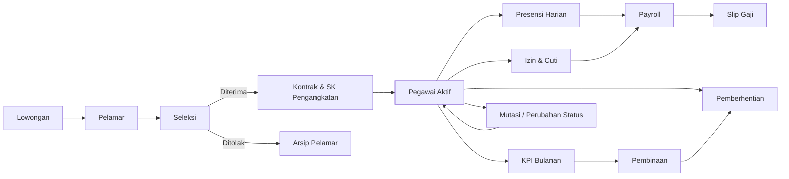

---

## 2. Rekrutmen dan penerimaan pegawai (Tahap 3)

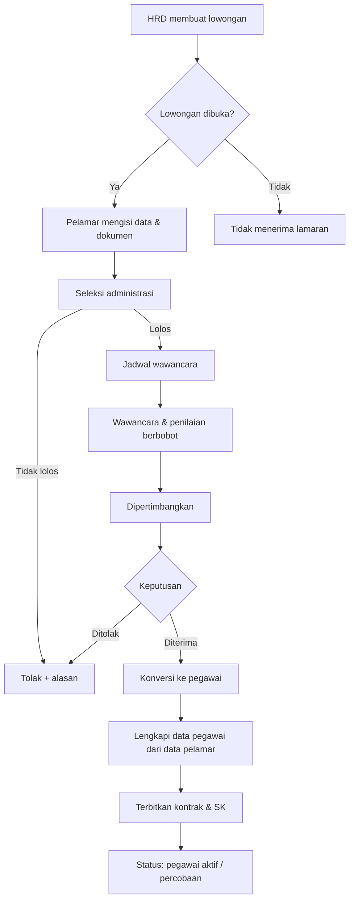

**Aturan**
- Konversi wajib memakai data pelamar yang ada (tanpa input ulang identitas utama).
- Satu pelamar hanya dapat dikonversi satu kali (`applicants.converted_employee_id` unik bila terisi).
- Keputusan penerimaan wajib memiliki alasan dan pelaku.
- Masa percobaan mengikuti konfigurasi `probation_months` (K-08).

---

## 3. Pengangkatan dan penetapan pegawai (Tahap 3)

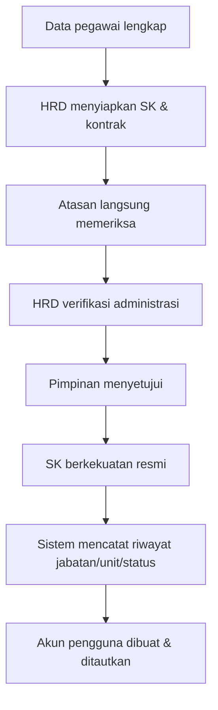

| Tahap | Pelaku | Keluaran |
|---|---|---|
| 1 | HRD | Draf SK, kontrak, penempatan |
| 2 | Kepala bagian | Persetujuan/penolakan atasan |
| 3 | HRD | Verifikasi kelengkapan |
| 4 | Pimpinan | Persetujuan akhir |
| 5 | Sistem | Riwayat + akun + audit |

---

## 4. Perubahan status pegawai (Tahap 3)

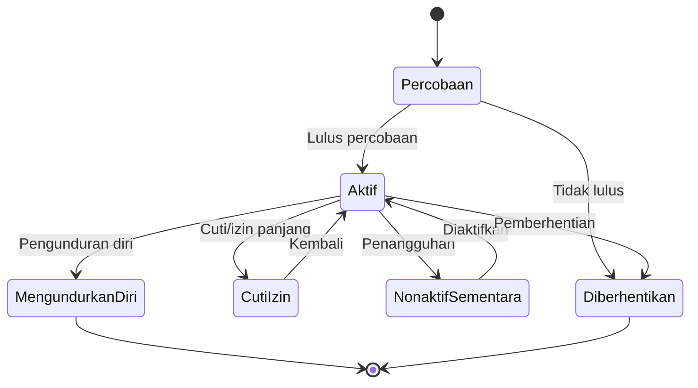

**Aturan wajib**
1. Perubahan hanya lewat form yang meminta: status baru, tanggal efektif, alasan, dokumen (jika perlu), pejabat penyetuju.
2. Baris `employee_status_histories` baru dibuat; baris lama tidak diubah.
3. Status `mengundurkan_diri`/`diberhentikan` menonaktifkan akun dan menutup akses presensi pada tanggal efektif.
4. Payroll memakai status pada rentang tanggal periode, bukan status hari ini.

---

## 5. Mutasi dan perubahan jabatan (Tahap 3)

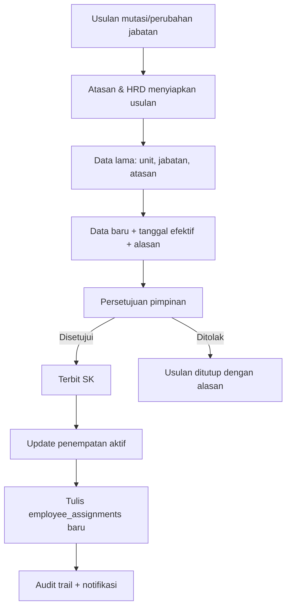

- Penempatan aktif = baris `employee_assignments` dengan `effective_to IS NULL`.
- Perubahan tidak boleh menimpa riwayat; penutupan baris lama memakai `effective_to` = H-1 tanggal efektif baru.

---

## 6. Presensi harian (Tahap 4)

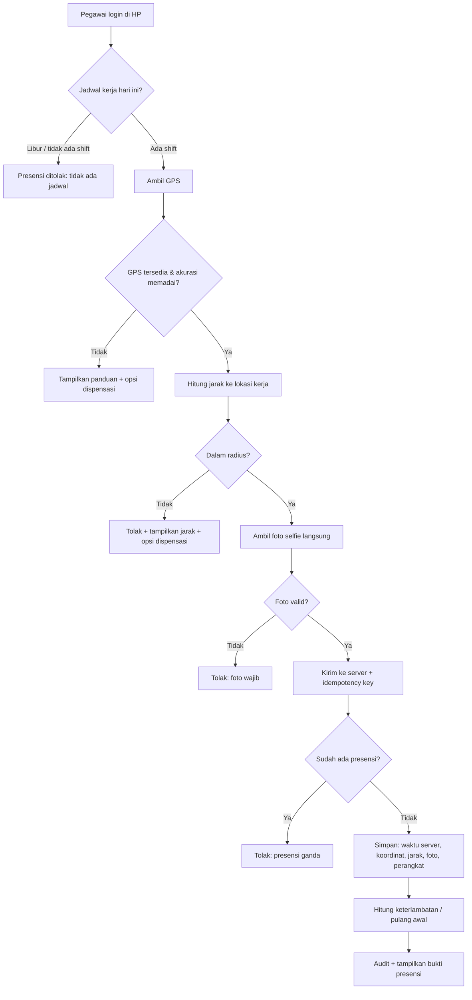

**Perhitungan keterlambatan**

```
jadwal_masuk   = shift.start_time (tanggal kerja, zona Asia/Jakarta)
batas_masuk    = jadwal_masuk + shift.late_tolerance_minutes
terlambat      = max(0, menit(check_in_at - batas_masuk))
pulang_awal    = max(0, menit(batas_pulang - check_out_at))
menit_kerja    = max(0, menit(check_out_at - check_in_at) - istirahat)
```

**Aturan**
- Waktu keputusan selalu `now()` server.
- Shift lintas hari: `work_date` tetap tanggal mulai shift.
- Libur nasional/pesantren: tidak dihitung alpa (kecuali pegawai punya shift khusus).
- Akurasi GPS di atas ambang (mis. 100 m, K-14) ditolak atau ditandai; keputusan final menunggu klarifikasi.
- Presensi di luar radius tanpa dispensasi tetap tercatat sebagai percobaan gagal (untuk audit), bukan sebagai kehadiran.

---

## 7. Koreksi absensi (Tahap 4)

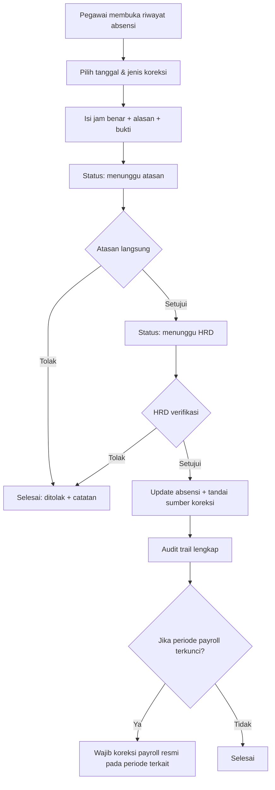

**Aturan**
- Koreksi tidak pernah menghapus nilai asli: nilai lama disimpan pada `attendance_corrections` dan audit trail.
- Setelah payroll dikunci, koreksi absensi menghasilkan penyesuaian payroll (bukan edit diam-diam).
- Pemohon tidak dapat menyetujui koreksinya sendiri; atasan yang juga pemohon harus dieskalasi ke HRD.

---

## 8. Izin dan cuti (Tahap 4)

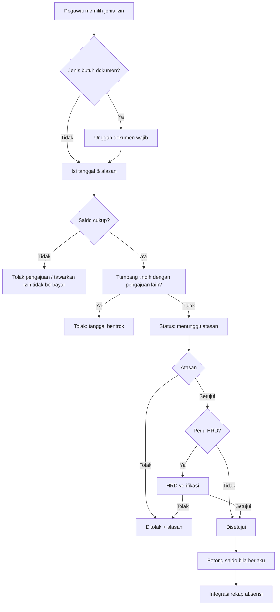

**Jenis izin awal:** izin pribadi, sakit, keluarga, cuti tahunan, dinas, dispensasi. Aturan saldo dan dokumen per jenis berada di `leave_types` (konfigurabel).

---

## 9. Penggajian (Tahap 5)

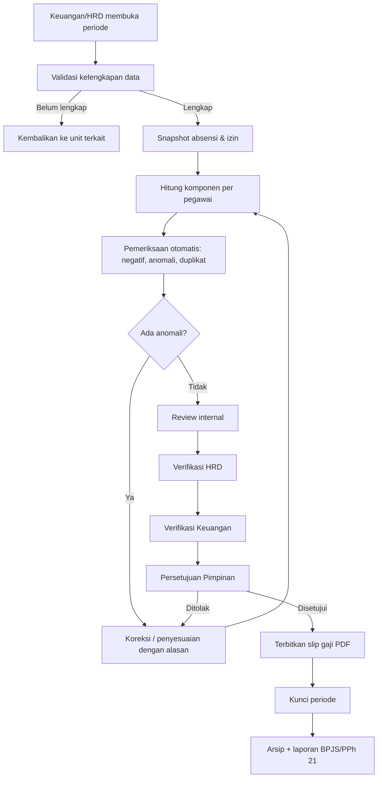

**Urutan status periode**

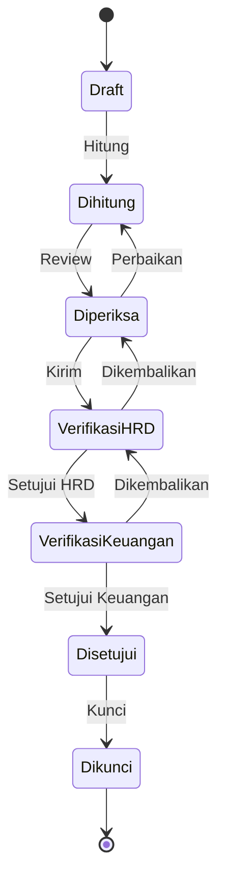

**Aturan perhitungan**
1. Semua tarif diambil dari konfigurasi dengan `effective_from <= periode` dan `effective_to IS NULL OR >= periode`.
2. Gaji pokok dihitung sesuai kategori; komponen yang tidak berlaku tidak menghasilkan baris.
3. Setiap baris `payroll_details` menyimpan: komponen, tipe, kuantitas, tarif, basis, hasil, catatan rumus, sumber data.
4. Potongan tidak boleh membuat gaji bersih negatif tanpa persetujuan eksplisit; sistem memberi peringatan.
5. Perhitungan ulang membuat `payroll_runs` versi baru; versi lama disimpan.
6. Periode terkunci tidak dapat diubah tanpa prosedur pembukaan (dicatat + disetujui).

**Rumus acuan (konfigurasi awal, wajib dikonfirmasi)**

```
gaji_harian_tetap     = hari_kalender_aktif × tarif_harian
potongan_alpa         = hari_alpa × tarif_potongan_harian
potongan_terlambat    = total_menit_terlambat × tarif_per_menit
basis_pendidikan      = tarif_pendidikan[level] (+ kenaikan tahunan 5%)
tunjangan_pasangan    = 200000 bila memenuhi syarat
tunjangan_anak        = 100000 × jumlah_anak_memenuhi_syarat
tunjangan_transport   = band_jarak(jarak_km)
tunjangan_kehadiran   = tarif_kehadiran (MSU/SD menggantikan yang lain)
bpjs_kesehatan_pegawai= 1% × basis_bpjs   (basis awal 4.200.000)
jht_pegawai           = 2% × basis_jht
pph21                 = f(bruto_setahun, PTKP, tarif_berlaku)
gaji_bersih           = total_penghasilan − total_potongan_pegawai
```

> Angka dan tafsir rumus yang belum pasti tercantum pada `CLARIFICATIONS.md` (K-01 s.d. K-12). Jangan menganggap contoh di atas sebagai ketentuan final.

---

## 10. KPI (Tahap 6)

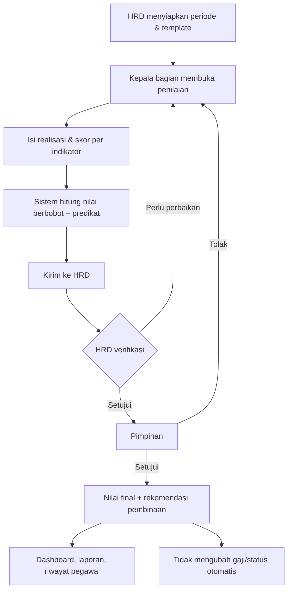

**Aturan**
- Bobot indikator per template harus berjumlah 100% (validasi simpan).
- Satu penilaian per pegawai/periode/template; nilai historis tidak diubah setelah disetujui.
- Evaluasi triwulanan merangkum tiga penilaian bulanan (metode agregasi dikonfigurasi, K-20).

---

## 11. Pembinaan pegawai (Tahap 6)

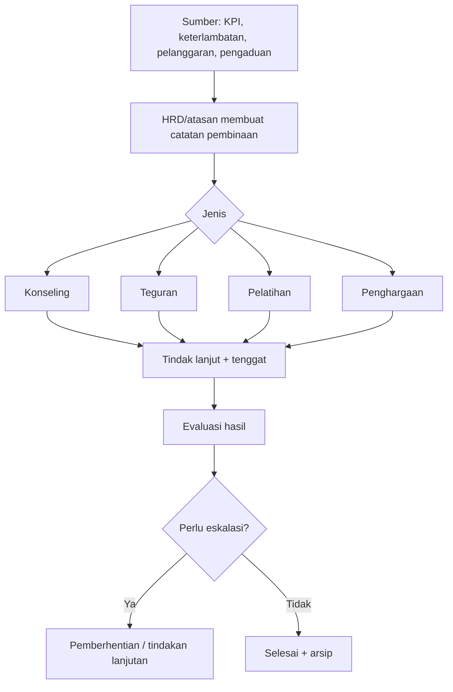

---

## 12. Pemberhentian (Tahap 3/6)

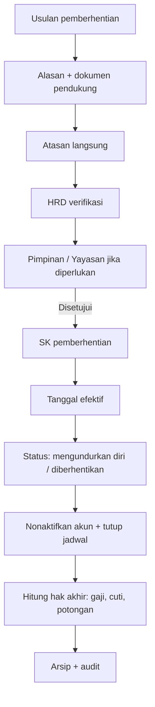

---

## 13. Kontrak dan perpanjangan (Tahap 3)

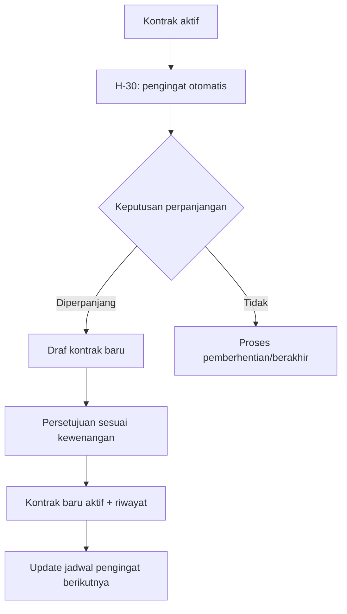

---

## 14. Matriks persetujuan (ringkas)

| Jenis pengajuan | Tingkat 1 | Tingkat 2 | Tingkat 3 | Catatan |
|---|---|---|---|---|
| Koreksi absensi | Atasan langsung | HRD | — | Wajib dua tingkat |
| Izin pribadi/keluarga | Atasan langsung | HRD | — | HRD memverifikasi administrasi |
| Sakit | Atasan langsung | HRD | — | Surat dokter wajib bila > 1 hari (K-16) |
| Cuti tahunan | Atasan langsung | HRD | — | Saldo cuti |
| Dinas | Atasan langsung | HRD | — | Dapat tanpa potongan |
| Kontrak kerja | HRD | Pimpinan | Yayasan (bila perlu) | Tergantung jenis |
| SK pengangkatan/mutasi | HRD | Pimpinan | Yayasan (bila perlu) | Setiap SK punya alur |
| Payroll | HRD | Keuangan | Pimpinan | Tidak boleh satu orang |
| KPI | Kepala bagian (penilai) | HRD | Pimpinan | Penilai ≠ verifikator |
| Pemberhentian | Atasan | HRD | Pimpinan/Yayasan | Wajib dokumen |
| Pembinaan berat | HRD | Pimpinan | — | Teguran berat/pemberhentian |

Rincian kewenangan per peran: `ACCESS_CONTROL.md`.

---

## 15. SLA proses (usulan, perlu persetujuan)

| Proses | Sasaran waktu |
|---|---|
| Koreksi absensi — atasan | ≤ 2 hari kerja |
| Koreksi absensi — HRD | ≤ 2 hari kerja |
| Izin/cuti | ≤ 2 hari kerja sebelum tanggal mulai (kecuali darurat) |
| Verifikasi payroll HRD | ≤ 2 hari kerja setelah perhitungan |
| Verifikasi payroll keuangan | ≤ 2 hari kerja |
| Persetujuan pimpinan | ≤ 3 hari kerja |
| Verifikasi KPI HRD | ≤ 5 hari kerja setelah penilaian |
| Persetujuan KPI pimpinan | ≤ 5 hari kerja |

SLA hanya menjadi pengingat/notifikasi; tidak mengubah status otomatis tanpa keputusan.
