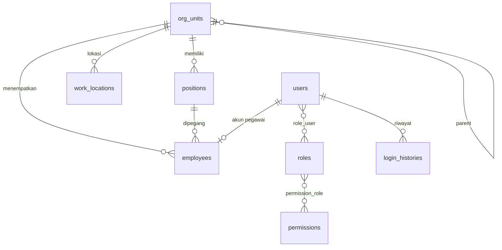
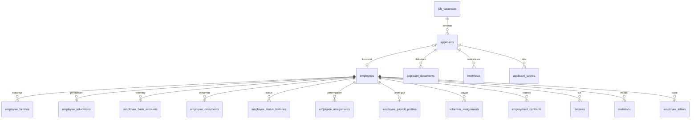
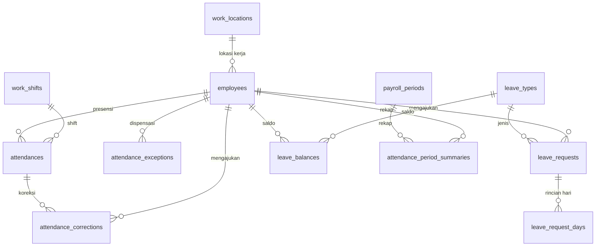
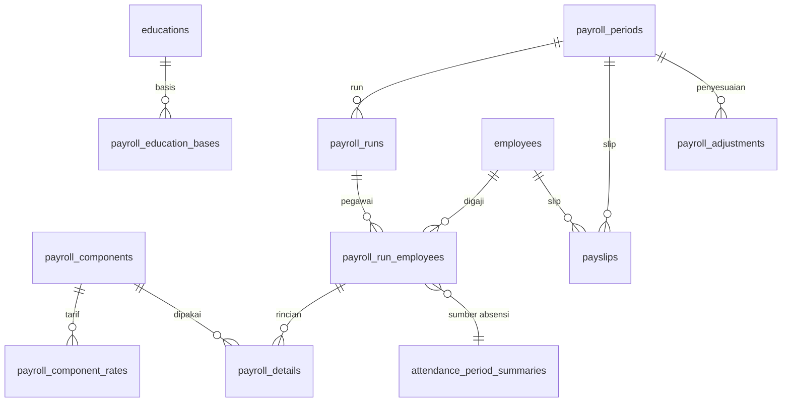
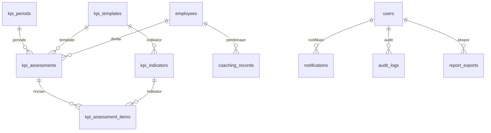

# DATABASE DESIGN — Aplikasi Kepegawaian PIS

| Atribut | Nilai |
|---|---|
| Versi | 1.0 |
| Tanggal | 18-11-2026 |
| DBMS | MySQL 8.4 (InnoDB, utf8mb4) |
| Nama database | `pis_kepegawaian` |
| Jumlah tabel | 78 (71 tabel domain + 7 tabel framework Laravel) |
| Status | Rancangan — menjadi acuan migration Tahap 2 dst. |

---

## 1. Konvensi

1. Nama tabel: `snake_case`, bentuk jamak (`employees`, `attendances`).
2. Primary key: `id` `BIGINT UNSIGNED AUTO_INCREMENT`.
3. Foreign key: `<tabel>_<kolom>`; contoh `employee_id` → `employees.id`.
4. Semua tabel memiliki `created_at`, `updated_at` (TIMESTAMP, UTC). Tabel tertentu memiliki `deleted_at` (soft delete).
5. Uang: `DECIMAL(15,2)`. Persentase: `DECIMAL(6,3)`. Koordinat: `DECIMAL(10,7)`. Jarak/akurasi: `DECIMAL(8,2)`. Menit: `SMALLINT UNSIGNED`.
6. Waktu disimpan **UTC**; ditampilkan `Asia/Jakarta`.
7. Status/enum disimpan sebagai `VARCHAR(30)` + `CHECK` constraint (MySQL 8) dan enum di aplikasi. Nilai yang diizinkan didokumentasikan per tabel.
8. Kolom `JSON` hanya untuk data fleksibel (snapshot aturan, metadata, error impor) — bukan untuk data yang perlu difilter/diagregasi.
9. Semua FK memakai `ON UPDATE RESTRICT`; `ON DELETE` dipilih eksplisit (RESTRICT untuk data transaksi, SET NULL untuk referensi opsional, CASCADE hanya untuk tabel anak murni).
10. Indeks wajib untuk kolom yang sering difilter: `employee_id`, `work_date`, `status`, `org_unit_id`, `payroll_period_id`.
11. Nama constraint: `fk_`, `uq_`, `idx_`, `chk_`.
12. Data sensitif (NIK, nomor rekening, NPWP) disimpan dengan cast terenkripsi Laravel (`encrypted`) dan/atau kontrol akses ketat; pencarian memakai hash kolom bila diperlukan (`nik_hash`).

### 1.1 Daftar tabel per domain

| Domain | Tabel |
|---|---|
| Akses | `users`, `roles`, `permissions`, `permission_role`, `role_user`, `login_histories`, `password_reset_tokens`, `sessions` |
| Organisasi & master | `org_units`, `positions`, `work_locations`, `educations`, `work_shifts`, `work_schedules`, `work_schedule_days`, `schedule_assignments`, `holidays`, `settings`, `number_sequences`, `document_templates` |
| Pegawai | `employees`, `employee_families`, `employee_educations`, `employee_bank_accounts`, `employee_documents`, `employee_status_histories`, `employee_assignments`, `employee_payroll_profiles`, `import_batches` |
| Rekrutmen | `job_vacancies`, `applicants`, `applicant_documents`, `interviews`, `applicant_scores` |
| Administrasi HRD | `employment_contracts`, `decrees`, `mutations`, `employee_letters` |
| Alur persetujuan | `approval_flows`, `approval_flow_steps`, `approval_instances`, `approval_actions` |
| Absensi | `attendances`, `attendance_corrections`, `attendance_exceptions`, `attendance_period_summaries` |
| Izin & cuti | `leave_types`, `leave_requests`, `leave_request_days`, `leave_balances` |
| Penggajian | `payroll_components`, `payroll_component_rates`, `payroll_education_bases`, `payroll_transport_bands`, `payroll_periods`, `payroll_runs`, `payroll_run_employees`, `payroll_details`, `payroll_adjustments`, `tax_brackets`, `tax_ptkp`, `bpjs_settings`, `payslips` |
| KPI & pembinaan | `kpi_periods`, `kpi_templates`, `kpi_indicators`, `kpi_assessments`, `kpi_assessment_items`, `coaching_records` |
| Sistem | `notifications`, `audit_logs`, `report_exports`, `system_backups`, `jobs`, `job_batches`, `failed_jobs`, `cache` |

---

## 2. ERD per domain

### 2.1 Akses dan organisasi

### 2.2 Pegawai, rekrutmen, administrasi

### 2.3 Absensi dan izin

### 2.4 Penggajian

### 2.5 KPI, pembinaan, dan sistem

---

## 3. Domain akses

### 3.1 `users`
Akun login. Satu akun dapat tertaut ke satu pegawai.

| Kolom | Tipe | Null | Aturan / keterangan |
|---|---|---|---|
| id | BIGINT UNSIGNED | tidak | PK |
| employee_id | BIGINT UNSIGNED | ya | FK `employees.id`, UNIQUE, `ON DELETE SET NULL` |
| name | VARCHAR(150) | tidak | Nama tampilan |
| username | VARCHAR(60) | tidak | UNIQUE, `^[a-z0-9._-]{4,60}$` |
| email | VARCHAR(150) | ya | UNIQUE (bila diisi), format email |
| password | VARCHAR(255) | tidak | Hash bcrypt/argon2id |
| is_active | BOOLEAN | tidak | default 1 |
| must_change_password | BOOLEAN | tidak | default 0 |
| last_login_at | TIMESTAMP | ya | Diisi saat login sukses |
| remember_token | VARCHAR(100) | ya | Framework |
| created_at/updated_at | TIMESTAMP | tidak | |
| deleted_at | TIMESTAMP | ya | Soft delete |

Indeks: `uq_users_username`, `uq_users_email`, `uq_users_employee_id`, `idx_users_is_active`.
Validasi: tidak boleh menghapus pengguna terakhir yang memiliki peran `administrator`.

### 3.2 `roles`
| Kolom | Tipe | Null | Keterangan |
|---|---|---|---|
| id | BIGINT UNSIGNED | tidak | PK |
| code | VARCHAR(50) | tidak | UNIQUE; `administrator`,`pimpinan`,`kepala_bagian`,`hrd`,`keuangan`,`pegawai` |
| name | VARCHAR(100) | tidak | Nama tampilan |
| description | VARCHAR(255) | ya | |
| is_system | BOOLEAN | tidak | default 0; role sistem tidak dapat dihapus |

Seed: 6 role di atas.

### 3.3 `permissions`
| Kolom | Tipe | Null | Keterangan |
|---|---|---|---|
| id | BIGINT UNSIGNED | tidak | PK |
| code | VARCHAR(100) | tidak | UNIQUE, format `modul.aksi` (lihat `ACCESS_CONTROL.md`) |
| name | VARCHAR(150) | tidak | |
| module | VARCHAR(50) | tidak | Indeks |
| description | VARCHAR(255) | ya | |

### 3.4 `permission_role`
| Kolom | Tipe | Null | Keterangan |
|---|---|---|---|
| permission_id | BIGINT UNSIGNED | tidak | FK `permissions.id`, CASCADE |
| role_id | BIGINT UNSIGNED | tidak | FK `roles.id`, CASCADE |

PK gabungan (`permission_id`, `role_id`). Indeks `role_id`.

### 3.5 `role_user`
| Kolom | Tipe | Null | Keterangan |
|---|---|---|---|
| user_id | BIGINT UNSIGNED | tidak | FK `users.id`, CASCADE |
| role_id | BIGINT UNSIGNED | tidak | FK `roles.id`, CASCADE |
| org_unit_id | BIGINT UNSIGNED | ya | FK `org_units.id`; bila diisi, peran berlaku untuk unit tersebut dan turunannya |

PK gabungan (`user_id`, `role_id`, `org_unit_id`). Satu pengguna dapat memiliki beberapa peran dengan cakupan unit berbeda.

### 3.6 `login_histories`
| Kolom | Tipe | Null | Keterangan |
|---|---|---|---|
| id | BIGINT UNSIGNED | tidak | PK |
| user_id | BIGINT UNSIGNED | ya | FK `users.id`, SET NULL (akun dapat dihapus) |
| username_attempt | VARCHAR(100) | tidak | Untuk audit percobaan gagal |
| success | BOOLEAN | tidak | |
| failure_reason | VARCHAR(100) | ya | `invalid_credentials`,`inactive`,`throttled` |
| ip_address | VARCHAR(45) | ya | IPv4/IPv6 |
| user_agent | VARCHAR(255) | ya | |
| login_at | TIMESTAMP | tidak | UTC |

Indeks: `idx_login_histories_user_at (user_id, login_at)`, `idx_login_histories_success`.

### 3.7 Tabel framework
`password_reset_tokens`, `sessions`, `cache`, `cache_locks`, `jobs`, `job_batches`, `failed_jobs`, `migrations` dibuat oleh Laravel; tidak diubah strukturnya.

---

## 4. Domain organisasi dan master data

### 4.1 `org_units`
| Kolom | Tipe | Null | Keterangan |
|---|---|---|---|
| id | BIGINT UNSIGNED | tidak | PK |
| parent_id | BIGINT UNSIGNED | ya | FK `org_units.id`, RESTRICT; NULL = root |
| code | VARCHAR(30) | tidak | UNIQUE |
| name | VARCHAR(150) | tidak | |
| type | VARCHAR(30) | tidak | `yayasan`,`pimpinan`,`bidang`,`bagian`,`seksi`,`unit_pendidikan` |
| level | TINYINT UNSIGNED | tidak | Dihitung dari kedalaman (1 = root) |
| leader_employee_id | BIGINT UNSIGNED | ya | FK `employees.id`, SET NULL — kepala unit aktif |
| address | VARCHAR(255) | ya | |
| phone | VARCHAR(30) | ya | |
| sort_order | SMALLINT | tidak | default 0 |
| is_active | BOOLEAN | tidak | default 1 |

Validasi: `parent_id != id`; tidak boleh membentuk siklus; `code` unik; level dihitung ulang saat parent berubah.

### 4.2 `positions`
| Kolom | Tipe | Null | Keterangan |
|---|---|---|---|
| id | BIGINT UNSIGNED | tidak | PK |
| org_unit_id | BIGINT UNSIGNED | ya | FK `org_units.id`, SET NULL |
| code | VARCHAR(30) | tidak | UNIQUE |
| name | VARCHAR(150) | tidak | |
| level | TINYINT UNSIGNED | ya | Urutan hierarki jabatan |
| is_active | BOOLEAN | tidak | default 1 |

### 4.3 `work_locations`
| Kolom | Tipe | Null | Keterangan |
|---|---|---|---|
| id | BIGINT UNSIGNED | tidak | PK |
| org_unit_id | BIGINT UNSIGNED | ya | FK `org_units.id`, SET NULL |
| code | VARCHAR(30) | tidak | UNIQUE |
| name | VARCHAR(150) | tidak | |
| address | VARCHAR(255) | ya | |
| latitude | DECIMAL(10,7) | tidak | -90..90 |
| longitude | DECIMAL(10,7) | tidak | -180..180 |
| radius_m | SMALLINT UNSIGNED | tidak | default 100; 10..5000 |
| accuracy_threshold_m | SMALLINT UNSIGNED | tidak | default 100; akurasi GPS maksimum yang diterima |
| is_active | BOOLEAN | tidak | default 1 |

### 4.4 `educations`
| Kolom | Tipe | Null | Keterangan |
|---|---|---|---|
| id | BIGINT UNSIGNED | tidak | PK |
| code | VARCHAR(20) | tidak | UNIQUE (`SD`,`SMP`,`SMA`,`D3`,`S1`,`S2`,`S3`) |
| name | VARCHAR(100) | tidak | |
| level_order | TINYINT UNSIGNED | tidak | Untuk perbandingan jenjang |
| is_active | BOOLEAN | tidak | default 1 |

### 4.5 `work_shifts`
| Kolom | Tipe | Null | Keterangan |
|---|---|---|---|
| id | BIGINT UNSIGNED | tidak | PK |
| code | VARCHAR(30) | tidak | UNIQUE |
| name | VARCHAR(100) | tidak | |
| start_time | TIME | tidak | |
| end_time | TIME | tidak | |
| is_cross_midnight | BOOLEAN | tidak | default 0 |
| break_minutes | SMALLINT UNSIGNED | tidak | default 0 |
| late_tolerance_minutes | SMALLINT UNSIGNED | tidak | default 0 |
| early_leave_tolerance_minutes | SMALLINT UNSIGNED | tidak | default 0 |
| is_active | BOOLEAN | tidak | default 1 |

### 4.6 `work_schedules`
| Kolom | Tipe | Null | Keterangan |
|---|---|---|---|
| id | BIGINT UNSIGNED | tidak | PK |
| name | VARCHAR(100) | tidak | |
| org_unit_id | BIGINT UNSIGNED | ya | FK `org_units.id`, SET NULL |
| employee_category | VARCHAR(30) | ya | `tetap`/`harian`/`khidmah`/NULL (semua) |
| effective_from | DATE | tidak | |
| effective_to | DATE | ya | NULL = berlaku |
| is_active | BOOLEAN | tidak | default 1 |

### 4.7 `work_schedule_days`
| Kolom | Tipe | Null | Keterangan |
|---|---|---|---|
| id | BIGINT UNSIGNED | tidak | PK |
| work_schedule_id | BIGINT UNSIGNED | tidak | FK `work_schedules.id`, CASCADE |
| day_of_week | TINYINT UNSIGNED | tidak | 1=Senin … 7=Minggu |
| shift_id | BIGINT UNSIGNED | ya | FK `work_shifts.id`, RESTRICT; NULL = libur |
| is_workday | BOOLEAN | tidak | default 1 |

UNIQUE (`work_schedule_id`, `day_of_week`).

### 4.8 `schedule_assignments`
| Kolom | Tipe | Null | Keterangan |
|---|---|---|---|
| id | BIGINT UNSIGNED | tidak | PK |
| employee_id | BIGINT UNSIGNED | tidak | FK `employees.id`, CASCADE |
| work_schedule_id | BIGINT UNSIGNED | tidak | FK `work_schedules.id`, RESTRICT |
| effective_from | DATE | tidak | |
| effective_to | DATE | ya | NULL = berlaku |
| created_by | BIGINT UNSIGNED | ya | FK `users.id`, SET NULL |

Indeks: `idx_schedule_assignments_employee_from (employee_id, effective_from)`.
Validasi aplikasi: rentang tanggal tidak boleh tumpang tindih untuk pegawai yang sama.

### 4.9 `holidays`
| Kolom | Tipe | Null | Keterangan |
|---|---|---|---|
| id | BIGINT UNSIGNED | tidak | PK |
| date | DATE | tidak | UNIQUE |
| name | VARCHAR(150) | tidak | |
| type | VARCHAR(30) | tidak | `nasional`,`pesantren` |
| is_paid | BOOLEAN | tidak | default 1 |

### 4.10 `settings`
| Kolom | Tipe | Null | Keterangan |
|---|---|---|---|
| id | BIGINT UNSIGNED | tidak | PK |
| group | VARCHAR(50) | tidak | `app`,`attendance`,`payroll`,`security`,`notification` |
| key | VARCHAR(100) | tidak | UNIQUE |
| value | TEXT | ya | Disimpan sebagai string/JSON |
| value_type | VARCHAR(20) | tidak | `string`,`integer`,`decimal`,`boolean`,`json`,`date` |
| effective_from | DATE | ya | Untuk kebijakan bertanggal |
| description | VARCHAR(255) | ya | |
| updated_by | BIGINT UNSIGNED | ya | FK `users.id`, SET NULL |

Contoh key: `app.name`, `attendance.default_radius_m`, `attendance.accuracy_threshold_m`, `attendance.max_photo_kb`, `payroll.rounding_mode`, `security.session_single_device`, `security.password_min_length`.

### 4.11 `number_sequences`
| Kolom | Tipe | Null | Keterangan |
|---|---|---|---|
| id | BIGINT UNSIGNED | tidak | PK |
| code | VARCHAR(50) | tidak | UNIQUE (`nip`,`contract`,`decree`,`letter`) |
| prefix | VARCHAR(30) | ya | |
| pattern | VARCHAR(100) | tidak | Contoh `{prefix}/{seq:4}/{year}` |
| next_number | BIGINT UNSIGNED | tidak | default 1 |
| padding | TINYINT UNSIGNED | tidak | default 4 |
| reset_period | VARCHAR(20) | tidak | `never`,`yearly`,`monthly` |
| last_reset_at | DATE | ya | |

Pengambilan nomor dilakukan dalam transaksi + `SELECT ... FOR UPDATE` untuk mencegah duplikasi.

### 4.12 `document_templates`
| Kolom | Tipe | Null | Keterangan |
|---|---|---|---|
| id | BIGINT UNSIGNED | tidak | PK |
| code | VARCHAR(50) | tidak | UNIQUE |
| name | VARCHAR(150) | tidak | |
| doc_type | VARCHAR(30) | tidak | `sk`,`kontrak`,`surat`,`slip` |
| body | LONGTEXT | tidak | HTML dengan placeholder `{{employee.nama}}` |
| variables | JSON | ya | Daftar variabel yang didukung |
| is_active | BOOLEAN | tidak | default 1 |

---

## 5. Domain pegawai

### 5.1 `employees`
| Kolom | Tipe | Null | Keterangan |
|---|---|---|---|
| id | BIGINT UNSIGNED | tidak | PK |
| nip | VARCHAR(30) | tidak | UNIQUE |
| nik | VARCHAR(255) | ya | Terenkripsi; UNIQUE tidak dapat langsung — gunakan `nik_hash CHAR(64)` UNIQUE |
| nik_hash | CHAR(64) | ya | SHA-256 dari NIK untuk pencarian/keunikan |
| full_name | VARCHAR(150) | tidak | Indeks (prefix) |
| nick_name | VARCHAR(60) | ya | |
| gender | VARCHAR(10) | tidak | `L`,`P` |
| birth_place | VARCHAR(100) | ya | |
| birth_date | DATE | ya | Tidak boleh di masa depan |
| religion | VARCHAR(30) | ya | |
| marital_status | VARCHAR(20) | tidak | `lajang`,`menikah`,`cerai`,`cerai_mati` |
| blood_type | VARCHAR(3) | ya | |
| address | VARCHAR(255) | ya | |
| village | VARCHAR(100) | ya | Desa/kelurahan |
| district | VARCHAR(100) | ya | Kecamatan |
| city | VARCHAR(100) | ya | Kabupaten/kota |
| province | VARCHAR(100) | ya | |
| postal_code | VARCHAR(10) | ya | |
| phone | VARCHAR(30) | ya | |
| email | VARCHAR(150) | ya | Format email |
| photo_path | VARCHAR(255) | ya | Privat |
| employee_category | VARCHAR(20) | tidak | `tetap`,`harian`,`khidmah` |
| khidmah_type | VARCHAR(20) | ya | `biasa`,`khusus`; wajib bila kategori khidmah |
| employment_status | VARCHAR(30) | tidak | `aktif`,`percobaan`,`cuti_izin`,`nonaktif_sementara`,`mengundurkan_diri`,`diberhentikan` |
| org_unit_id | BIGINT UNSIGNED | ya | FK `org_units.id`, SET NULL |
| position_id | BIGINT UNSIGNED | ya | FK `positions.id`, SET NULL |
| direct_supervisor_id | BIGINT UNSIGNED | ya | FK `employees.id`, SET NULL; tidak boleh diri sendiri |
| work_location_id | BIGINT UNSIGNED | ya | FK `work_locations.id`, SET NULL |
| hire_date | DATE | tidak | Tanggal mulai kerja |
| probation_end_date | DATE | ya | >= hire_date |
| termination_date | DATE | ya | Wajib bila status berhenti |
| termination_reason | VARCHAR(255) | ya | |
| is_active | BOOLEAN | tidak | default 1; turunan status untuk query cepat |
| created_by | BIGINT UNSIGNED | ya | FK `users.id`, SET NULL |
| created_at/updated_at | TIMESTAMP | tidak | |
| deleted_at | TIMESTAMP | ya | Soft delete |

Indeks: `idx_employees_unit`, `idx_employees_status`, `idx_employees_category`, `idx_employees_name (full_name)`, `idx_employees_supervisor (direct_supervisor_id)`.
Validasi: NIP unik; NIK 16 digit; `khidmah_type` wajib untuk kategori `khidmah`; pegawai tidak boleh menjadi atasan dirinya sendiri; `termination_date` wajib untuk status berhenti.

### 5.2 `employee_families`
| Kolom | Tipe | Null | Keterangan |
|---|---|---|---|
| id | BIGINT UNSIGNED | tidak | PK |
| employee_id | BIGINT UNSIGNED | tidak | FK `employees.id`, CASCADE |
| relation | VARCHAR(20) | tidak | `pasangan`,`anak`,`anggota` |
| name | VARCHAR(150) | tidak | |
| nik | VARCHAR(255) | ya | Terenkripsi |
| gender | VARCHAR(10) | ya | |
| birth_date | DATE | ya | Wajib untuk anak |
| education | VARCHAR(50) | ya | |
| occupation | VARCHAR(100) | ya | |
| is_dependent | BOOLEAN | tidak | default 1; memengaruhi tunjangan |
| is_working_at_pis | BOOLEAN | tidak | default 0; untuk aturan tunjangan pasangan |
| marriage_date | DATE | ya | |
| notes | VARCHAR(255) | ya | |

Indeks: `idx_employee_families_employee (employee_id)`.
Validasi: maksimal satu pasangan aktif per pegawai (aturan aplikasi); anak dengan `is_dependent=1` dibatasi sesuai kebijakan (K-05).

### 5.3 `employee_educations`
| Kolom | Tipe | Null | Keterangan |
|---|---|---|---|
| id | BIGINT UNSIGNED | tidak | PK |
| employee_id | BIGINT UNSIGNED | tidak | FK `employees.id`, CASCADE |
| education_id | BIGINT UNSIGNED | tidak | FK `educations.id`, RESTRICT |
| institution | VARCHAR(150) | tidak | |
| major | VARCHAR(100) | ya | |
| graduation_year | SMALLINT UNSIGNED | ya | 1950..tahun berjalan |
| certificate_path | VARCHAR(255) | ya | Privat |
| is_highest | BOOLEAN | tidak | default 0; hanya satu per pegawai |

### 5.4 `employee_bank_accounts`
| Kolom | Tipe | Null | Keterangan |
|---|---|---|---|
| id | BIGINT UNSIGNED | tidak | PK |
| employee_id | BIGINT UNSIGNED | tidak | FK `employees.id`, CASCADE |
| bank_name | VARCHAR(100) | tidak | |
| account_number | VARCHAR(255) | tidak | Terenkripsi |
| account_holder | VARCHAR(150) | tidak | |
| is_primary | BOOLEAN | tidak | default 0; satu per pegawai |

### 5.5 `employee_documents`
| Kolom | Tipe | Null | Keterangan |
|---|---|---|---|
| id | BIGINT UNSIGNED | tidak | PK |
| employee_id | BIGINT UNSIGNED | tidak | FK `employees.id`, CASCADE |
| doc_type | VARCHAR(50) | tidak | `ktp`,`kk`,`ijazah`,`sertifikat`,`npwp`,`bpjs`,`kontrak`,`sk`,`lain` |
| number | VARCHAR(100) | ya | |
| issued_date | DATE | ya | |
| expiry_date | DATE | ya | |
| file_path | VARCHAR(255) | tidak | Privat |
| is_confidential | BOOLEAN | tidak | default 0 |
| uploaded_by | BIGINT UNSIGNED | ya | FK `users.id`, SET NULL |
| verified_at | TIMESTAMP | ya | |
| verified_by | BIGINT UNSIGNED | ya | FK `users.id`, SET NULL |

Indeks: `idx_employee_documents_expiry (expiry_date)`, `idx_employee_documents_employee (employee_id)`.

### 5.6 `employee_status_histories`
| Kolom | Tipe | Null | Keterangan |
|---|---|---|---|
| id | BIGINT UNSIGNED | tidak | PK |
| employee_id | BIGINT UNSIGNED | tidak | FK `employees.id`, CASCADE |
| status | VARCHAR(30) | tidak | Status baru |
| effective_date | DATE | tidak | |
| reason | VARCHAR(255) | tidak | |
| document_path | VARCHAR(255) | ya | |
| approved_by | BIGINT UNSIGNED | ya | FK `users.id`, SET NULL |
| created_by | BIGINT UNSIGNED | ya | FK `users.id`, SET NULL |
| created_at | TIMESTAMP | tidak | |

Indeks: `idx_employee_status_histories_employee_date (employee_id, effective_date)`. Tidak boleh UPDATE/DELETE (append-only).

### 5.7 `employee_assignments`
Riwayat penempatan (unit, jabatan, atasan, lokasi).

| Kolom | Tipe | Null | Keterangan |
|---|---|---|---|
| id | BIGINT UNSIGNED | tidak | PK |
| employee_id | BIGINT UNSIGNED | tidak | FK `employees.id`, CASCADE |
| org_unit_id | BIGINT UNSIGNED | tidak | FK `org_units.id`, RESTRICT |
| position_id | BIGINT UNSIGNED | tidak | FK `positions.id`, RESTRICT |
| direct_supervisor_id | BIGINT UNSIGNED | ya | FK `employees.id`, SET NULL |
| work_location_id | BIGINT UNSIGNED | ya | FK `work_locations.id`, SET NULL |
| effective_from | DATE | tidak | |
| effective_to | DATE | ya | NULL = aktif |
| decision_number | VARCHAR(100) | ya | Nomor SK |
| reason | VARCHAR(255) | ya | |
| created_by | BIGINT UNSIGNED | ya | FK `users.id`, SET NULL |

Aturan: hanya satu baris aktif (`effective_to IS NULL`) per pegawai; enforced di aplikasi + transaction lock.

### 5.8 `employee_payroll_profiles`
| Kolom | Tipe | Null | Keterangan |
|---|---|---|---|
| id | BIGINT UNSIGNED | tidak | PK |
| employee_id | BIGINT UNSIGNED | tidak | FK `employees.id`, CASCADE, UNIQUE |
| education_id | BIGINT UNSIGNED | ya | FK `educations.id`, SET NULL (jenjang yang dipakai basis gaji) |
| transport_distance_km | DECIMAL(6,2) | ya | 0..100 |
| position_allowance_class | VARCHAR(20) | ya | `utama`,`tambahan`,`istimewa`,`tidak_ada` |
| bpjs_kesehatan_no | VARCHAR(50) | ya | |
| bpjs_tk_no | VARCHAR(50) | ya | |
| npwp | VARCHAR(255) | ya | Terenkripsi |
| tax_status | VARCHAR(10) | ya | `TK/0`,`K/0`,`K/1`,`K/2`,`K/3` |
| dependents_count | TINYINT UNSIGNED | tidak | default 0; 0..3 |
| salary_basis_override | DECIMAL(15,2) | ya | Hanya dengan persetujuan; tercatat alasannya |
| override_reason | VARCHAR(255) | ya | |
| effective_from | DATE | tidak | |
| updated_by | BIGINT UNSIGNED | ya | FK `users.id`, SET NULL |

Perubahan profil gaji wajib melalui audit dan hanya oleh HRD/Keuangan.

### 5.9 `import_batches`
| Kolom | Tipe | Null | Keterangan |
|---|---|---|---|
| id | BIGINT UNSIGNED | tidak | PK |
| module | VARCHAR(50) | tidak | `employees`,`salaries`,`attendance` |
| file_name | VARCHAR(255) | tidak | |
| total_rows | INT UNSIGNED | tidak | default 0 |
| success_rows | INT UNSIGNED | tidak | default 0 |
| failed_rows | INT UNSIGNED | tidak | default 0 |
| status | VARCHAR(20) | tidak | `processing`,`completed`,`completed_with_errors`,`failed` |
| errors | JSON | ya | Daftar baris + pesan |
| created_by | BIGINT UNSIGNED | ya | FK `users.id`, SET NULL |
| created_at/updated_at | TIMESTAMP | tidak | |

---

## 6. Domain rekrutmen

### 6.1 `job_vacancies`
| Kolom | Tipe | Null | Keterangan |
|---|---|---|---|
| id | BIGINT UNSIGNED | tidak | PK |
| code | VARCHAR(30) | tidak | UNIQUE |
| title | VARCHAR(150) | tidak | |
| org_unit_id | BIGINT UNSIGNED | tidak | FK `org_units.id`, RESTRICT |
| position_id | BIGINT UNSIGNED | ya | FK `positions.id`, SET NULL |
| employee_category | VARCHAR(20) | tidak | `tetap`,`harian`,`khidmah` |
| quota | SMALLINT UNSIGNED | tidak | default 1 |
| description | TEXT | ya | |
| requirements | TEXT | ya | |
| open_date | DATE | tidak | |
| close_date | DATE | tidak | >= open_date |
| status | VARCHAR(20) | tidak | `draft`,`dibuka`,`ditutup`,`dibatalkan` |
| created_by | BIGINT UNSIGNED | ya | FK `users.id`, SET NULL |

### 6.2 `applicants`
| Kolom | Tipe | Null | Keterangan |
|---|---|---|---|
| id | BIGINT UNSIGNED | tidak | PK |
| vacancy_id | BIGINT UNSIGNED | tidak | FK `job_vacancies.id`, CASCADE |
| code | VARCHAR(30) | tidak | UNIQUE |
| full_name | VARCHAR(150) | tidak | |
| nik | VARCHAR(255) | ya | Terenkripsi |
| birth_place | VARCHAR(100) | ya | |
| birth_date | DATE | ya | |
| gender | VARCHAR(10) | ya | |
| phone | VARCHAR(30) | tidak | |
| email | VARCHAR(150) | ya | |
| address | VARCHAR(255) | ya | |
| education_id | BIGINT UNSIGNED | ya | FK `educations.id`, SET NULL |
| experience_years | TINYINT UNSIGNED | ya | |
| expected_salary | DECIMAL(15,2) | ya | |
| source | VARCHAR(50) | ya | |
| status | VARCHAR(30) | tidak | `baru`,`seleksi_administrasi`,`wawancara`,`dipertimbangkan`,`diterima`,`ditolak` |
| final_score | DECIMAL(6,2) | ya | 0..100 |
| notes | TEXT | ya | |
| converted_employee_id | BIGINT UNSIGNED | ya | FK `employees.id`, SET NULL, UNIQUE |
| created_at/updated_at | TIMESTAMP | tidak | |
| deleted_at | TIMESTAMP | ya | |

Indeks: `idx_applicants_vacancy_status (vacancy_id, status)`. Validasi: konversi hanya untuk status `diterima`; satu pelamar satu konversi.

### 6.3 `applicant_documents`
| Kolom | Tipe | Null | Keterangan |
|---|---|---|---|
| id | BIGINT UNSIGNED | tidak | PK |
| applicant_id | BIGINT UNSIGNED | tidak | FK `applicants.id`, CASCADE |
| doc_type | VARCHAR(50) | tidak | |
| file_path | VARCHAR(255) | tidak | Privat |
| uploaded_at | TIMESTAMP | tidak | |

### 6.4 `interviews`
| Kolom | Tipe | Null | Keterangan |
|---|---|---|---|
| id | BIGINT UNSIGNED | tidak | PK |
| applicant_id | BIGINT UNSIGNED | tidak | FK `applicants.id`, CASCADE |
| stage | VARCHAR(30) | tidak | `hrd`,`kepala_bagian`,`pimpinan` |
| scheduled_at | TIMESTAMP | tidak | |
| interviewer_id | BIGINT UNSIGNED | ya | FK `employees.id`, SET NULL |
| mode | VARCHAR(20) | tidak | `tatap_muka`,`online` |
| location | VARCHAR(255) | ya | |
| score | DECIMAL(6,2) | ya | 0..100 |
| notes | TEXT | ya | |
| result | VARCHAR(20) | ya | `lulus`,`tidak_lulus`,`ditunda` |
| status | VARCHAR(20) | tidak | `dijadwalkan`,`selesai`,`dibatalkan` |

### 6.5 `applicant_scores`
| Kolom | Tipe | Null | Keterangan |
|---|---|---|---|
| id | BIGINT UNSIGNED | tidak | PK |
| applicant_id | BIGINT UNSIGNED | tidak | FK `applicants.id`, CASCADE |
| criterion | VARCHAR(100) | tidak | |
| weight | DECIMAL(6,3) | tidak | 0..100 |
| score | DECIMAL(6,2) | tidak | 0..100 |
| notes | VARCHAR(255) | ya | |
| scored_by | BIGINT UNSIGNED | ya | FK `users.id`, SET NULL |

Validasi: total bobot per pelamar = 100 (toleransi 0,01).

---

## 7. Domain administrasi HRD

### 7.1 `employment_contracts`
| Kolom | Tipe | Null | Keterangan |
|---|---|---|---|
| id | BIGINT UNSIGNED | tidak | PK |
| employee_id | BIGINT UNSIGNED | tidak | FK `employees.id`, CASCADE |
| contract_number | VARCHAR(100) | tidak | UNIQUE |
| contract_type | VARCHAR(30) | tidak | `pkwtt`,`pkwt`,`percobaan`,`khidmah` |
| start_date | DATE | tidak | |
| end_date | DATE | ya | NULL untuk tidak berbatas waktu |
| probation_end_date | DATE | ya | |
| status | VARCHAR(20) | tidak | `draf`,`aktif`,`akan_berakhir`,`berakhir`,`diperpanjang`,`dibatalkan` |
| document_path | VARCHAR(255) | ya | |
| signed_date | DATE | ya | |
| previous_contract_id | BIGINT UNSIGNED | ya | FK `employment_contracts.id`, SET NULL |
| notes | TEXT | ya | |
| created_by | BIGINT UNSIGNED | ya | FK `users.id`, SET NULL |

Indeks: `idx_employment_contracts_end_date (end_date)`, `idx_employment_contracts_employee (employee_id)`.

### 7.2 `decrees`
| Kolom | Tipe | Null | Keterangan |
|---|---|---|---|
| id | BIGINT UNSIGNED | tidak | PK |
| employee_id | BIGINT UNSIGNED | tidak | FK `employees.id`, CASCADE |
| decree_type | VARCHAR(40) | tidak | `pengangkatan`,`penempatan`,`perubahan_jabatan`,`mutasi`,`pemberhentian`,`lain` |
| number | VARCHAR(100) | tidak | UNIQUE |
| decree_date | DATE | tidak | |
| effective_date | DATE | tidak | |
| title | VARCHAR(255) | tidak | |
| description | TEXT | ya | |
| document_path | VARCHAR(255) | ya | |
| status | VARCHAR(20) | tidak | `draf`,`menunggu_persetujuan`,`disetujui`,`ditolak`,`dibatalkan` |
| approved_by | BIGINT UNSIGNED | ya | FK `users.id`, SET NULL |
| approved_at | TIMESTAMP | ya | |
| created_by | BIGINT UNSIGNED | ya | FK `users.id`, SET NULL |

### 7.3 `mutations`
| Kolom | Tipe | Null | Keterangan |
|---|---|---|---|
| id | BIGINT UNSIGNED | tidak | PK |
| employee_id | BIGINT UNSIGNED | tidak | FK `employees.id`, CASCADE |
| mutation_type | VARCHAR(30) | tidak | `mutasi`,`promosi`,`demosi`,`perubahan_jabatan`,`penempatan_ulang` |
| from_org_unit_id | BIGINT UNSIGNED | ya | FK `org_units.id`, SET NULL |
| to_org_unit_id | BIGINT UNSIGNED | ya | FK `org_units.id`, SET NULL |
| from_position_id | BIGINT UNSIGNED | ya | FK `positions.id`, SET NULL |
| to_position_id | BIGINT UNSIGNED | ya | FK `positions.id`, SET NULL |
| from_supervisor_id | BIGINT UNSIGNED | ya | FK `employees.id`, SET NULL |
| to_supervisor_id | BIGINT UNSIGNED | ya | FK `employees.id`, SET NULL |
| effective_date | DATE | tidak | |
| reason | VARCHAR(255) | tidak | |
| decree_id | BIGINT UNSIGNED | ya | FK `decrees.id`, SET NULL |
| status | VARCHAR(20) | tidak | `draf`,`menunggu`,`disetujui`,`ditolak`,`diterapkan` |
| requested_by | BIGINT UNSIGNED | ya | FK `users.id`, SET NULL |
| approved_by | BIGINT UNSIGNED | ya | FK `users.id`, SET NULL |

### 7.4 `employee_letters`
| Kolom | Tipe | Null | Keterangan |
|---|---|---|---|
| id | BIGINT UNSIGNED | tidak | PK |
| employee_id | BIGINT UNSIGNED | tidak | FK `employees.id`, CASCADE |
| letter_type | VARCHAR(40) | tidak | `teguran`,`pembinaan`,`pemberhentian`,`keterangan`,`lain` |
| number | VARCHAR(100) | tidak | UNIQUE |
| letter_date | DATE | tidak | |
| subject | VARCHAR(255) | tidak | |
| body | LONGTEXT | ya | |
| document_path | VARCHAR(255) | ya | |
| status | VARCHAR(20) | tidak | `draf`,`menunggu_persetujuan`,`disetujui`,`terkirim`,`dibatalkan` |
| coaching_record_id | BIGINT UNSIGNED | ya | FK `coaching_records.id`, SET NULL |
| created_by | BIGINT UNSIGNED | ya | FK `users.id`, SET NULL |
| approved_by | BIGINT UNSIGNED | ya | FK `users.id`, SET NULL |

---

## 8. Domain alur persetujuan

### 8.1 `approval_flows`
| Kolom | Tipe | Null | Keterangan |
|---|---|---|---|
| id | BIGINT UNSIGNED | tidak | PK |
| code | VARCHAR(50) | tidak | UNIQUE (`leave`,`attendance_correction`,`payroll`,`kpi`,`decree`,`contract`) |
| name | VARCHAR(150) | tidak | |
| subject_type | VARCHAR(100) | tidak | Nama model/entitas |
| is_active | BOOLEAN | tidak | default 1 |

### 8.2 `approval_flow_steps`
| Kolom | Tipe | Null | Keterangan |
|---|---|---|---|
| id | BIGINT UNSIGNED | tidak | PK |
| approval_flow_id | BIGINT UNSIGNED | tidak | FK `approval_flows.id`, CASCADE |
| sequence | TINYINT UNSIGNED | tidak | Mulai 1 |
| role_id | BIGINT UNSIGNED | tidak | FK `roles.id`, RESTRICT |
| scope | VARCHAR(20) | tidak | `self`,`unit`,`all` — penentuan approver konkret |
| is_optional | BOOLEAN | tidak | default 0 |

UNIQUE (`approval_flow_id`, `sequence`).

### 8.3 `approval_instances`
| Kolom | Tipe | Null | Keterangan |
|---|---|---|---|
| id | BIGINT UNSIGNED | tidak | PK |
| approval_flow_id | BIGINT UNSIGNED | tidak | FK `approval_flows.id`, RESTRICT |
| subject_type | VARCHAR(100) | tidak | |
| subject_id | BIGINT UNSIGNED | tidak | ID entitas (mis. leave_requests.id) |
| status | VARCHAR(20) | tidak | `menunggu`,`disetujui`,`ditolak`,`dibatalkan`,`kedaluwarsa` |
| current_step | TINYINT UNSIGNED | tidak | default 1 |
| requested_by | BIGINT UNSIGNED | tidak | FK `users.id`, RESTRICT |
| requested_at | TIMESTAMP | tidak | |
| completed_at | TIMESTAMP | ya | |

Indeks: `idx_approval_instances_subject (subject_type, subject_id)`, `idx_approval_instances_status`.

### 8.4 `approval_actions`
| Kolom | Tipe | Null | Keterangan |
|---|---|---|---|
| id | BIGINT UNSIGNED | tidak | PK |
| approval_instance_id | BIGINT UNSIGNED | tidak | FK `approval_instances.id`, CASCADE |
| sequence | TINYINT UNSIGNED | tidak | |
| actor_id | BIGINT UNSIGNED | tidak | FK `users.id`, RESTRICT |
| action | VARCHAR(20) | tidak | `setuju`,`tolak`,`kembalikan` |
| note | TEXT | ya | Wajib untuk `tolak`/`kembalikan` |
| acted_at | TIMESTAMP | tidak | |

Validasi: `actor_id != approval_instances.requested_by` (kecuali administrator darurat dengan audit khusus).

## 9. Domain absensi

### 9.1 `attendances`
Satu baris per pegawai + tanggal kerja + shift.

| Kolom | Tipe | Null | Aturan / keterangan |
|---|---|---|---|
| id | BIGINT UNSIGNED | tidak | PK |
| employee_id | BIGINT UNSIGNED | tidak | FK `employees.id`, RESTRICT |
| work_date | DATE | tidak | Tanggal mulai shift (Asia/Jakarta) |
| shift_id | BIGINT UNSIGNED | tidak | FK `work_shifts.id`, RESTRICT |
| schedule_assignment_id | BIGINT UNSIGNED | ya | FK `schedule_assignments.id`, SET NULL |
| check_in_at | TIMESTAMP | ya | Waktu server (UTC) |
| check_in_lat | DECIMAL(10,7) | ya | |
| check_in_lng | DECIMAL(10,7) | ya | |
| check_in_accuracy_m | DECIMAL(8,2) | ya | Akurasi GPS dari perangkat |
| check_in_distance_m | DECIMAL(8,2) | ya | Hasil hitung haversine |
| check_in_photo_path | VARCHAR(255) | ya | Privat |
| check_in_ip | VARCHAR(45) | ya | |
| check_in_user_agent | VARCHAR(255) | ya | |
| check_in_idempotency_key | CHAR(36) | ya | UNIQUE; mencegah duplikasi retry |
| check_out_at | TIMESTAMP | ya | |
| check_out_lat | DECIMAL(10,7) | ya | |
| check_out_lng | DECIMAL(10,7) | ya | |
| check_out_accuracy_m | DECIMAL(8,2) | ya | |
| check_out_distance_m | DECIMAL(8,2) | ya | |
| check_out_photo_path | VARCHAR(255) | ya | |
| check_out_ip | VARCHAR(45) | ya | |
| check_out_user_agent | VARCHAR(255) | ya | |
| check_out_idempotency_key | CHAR(36) | ya | UNIQUE |
| late_minutes | SMALLINT UNSIGNED | tidak | default 0 |
| early_leave_minutes | SMALLINT UNSIGNED | tidak | default 0 |
| work_minutes | SMALLINT UNSIGNED | tidak | default 0 |
| status | VARCHAR(30) | tidak | `hadir`,`terlambat`,`pulang_awal`,`tidak_hadir`,`izin`,`sakit`,`dispensasi`,`libur` |
| source | VARCHAR(20) | tidak | `self`,`correction`,`import`,`system` |
| is_corrected | BOOLEAN | tidak | default 0 |
| is_locked | BOOLEAN | tidak | default 0; terkunci setelah payroll |
| payroll_period_id | BIGINT UNSIGNED | ya | FK `payroll_periods.id`, SET NULL |
| notes | VARCHAR(255) | ya | |
| created_at/updated_at | TIMESTAMP | tidak | |

UNIQUE `uq_attendances_employee_date_shift (employee_id, work_date, shift_id)`.
UNIQUE `uq_attendances_check_in_key (check_in_idempotency_key)`, `uq_attendances_check_out_key (check_out_idempotency_key)`.
Indeks: `idx_attendances_date (work_date)`, `idx_attendances_period (payroll_period_id)`, `idx_attendances_status (status)`.
Aturan: `check_out_at >= check_in_at`; foto wajib untuk presensi mandiri; perubahan setelah `is_locked=1` ditolak kecuali via koreksi resmi.

### 9.2 `attendance_corrections`
| Kolom | Tipe | Null | Keterangan |
|---|---|---|---|
| id | BIGINT UNSIGNED | tidak | PK |
| employee_id | BIGINT UNSIGNED | tidak | FK `employees.id`, CASCADE |
| attendance_id | BIGINT UNSIGNED | ya | FK `attendances.id`, SET NULL |
| work_date | DATE | tidak | |
| correction_type | VARCHAR(30) | tidak | `masuk`,`pulang`,`keduanya`,`tidak_hadir`,`status` |
| requested_check_in_at | TIMESTAMP | ya | |
| requested_check_out_at | TIMESTAMP | ya | |
| reason | TEXT | tidak | Wajib, min 10 karakter |
| evidence_path | VARCHAR(255) | ya | |
| status | VARCHAR(30) | tidak | `menunggu_atasan`,`menunggu_hrd`,`disetujui`,`ditolak`,`dibatalkan` |
| supervisor_id | BIGINT UNSIGNED | ya | FK `employees.id`, SET NULL |
| supervisor_decision_at | TIMESTAMP | ya | |
| supervisor_note | TEXT | ya | |
| hrd_id | BIGINT UNSIGNED | ya | FK `users.id`, SET NULL |
| hrd_decision_at | TIMESTAMP | ya | |
| hrd_note | TEXT | ya | |
| applied_at | TIMESTAMP | ya | Saat perubahan diterapkan ke `attendances` |
| created_at/updated_at | TIMESTAMP | tidak | |

Indeks: `idx_corrections_employee_date (employee_id, work_date)`, `idx_corrections_status`.

### 9.3 `attendance_exceptions`
Dispensasi karena GPS/kamera/perangkat bermasalah atau penugasan luar.

| Kolom | Tipe | Null | Keterangan |
|---|---|---|---|
| id | BIGINT UNSIGNED | tidak | PK |
| employee_id | BIGINT UNSIGNED | tidak | FK `employees.id`, CASCADE |
| work_date | DATE | tidak | |
| type | VARCHAR(30) | tidak | `gps_tidak_tersedia`,`kamera_tidak_tersedia`,`penugasan_luar`,`darurat` |
| check_in_at | TIMESTAMP | ya | Waktu yang diajukan |
| check_out_at | TIMESTAMP | ya | |
| reason | TEXT | tidak | |
| evidence_path | VARCHAR(255) | ya | |
| status | VARCHAR(30) | tidak | `menunggu`,`disetujui`,`ditolak` |
| approved_by | BIGINT UNSIGNED | ya | FK `users.id`, SET NULL |
| approved_at | TIMESTAMP | ya | |
| created_at/updated_at | TIMESTAMP | tidak | |

Dispensasi disetujui tidak menghapus catatan kegagalan presensi; keduanya terlihat di audit.

### 9.4 `leave_types`
| Kolom | Tipe | Null | Keterangan |
|---|---|---|---|
| id | BIGINT UNSIGNED | tidak | PK |
| code | VARCHAR(30) | tidak | UNIQUE (`izin_pribadi`,`sakit`,`keluarga`,`cuti_tahunan`,`dinas`,`dispensasi`) |
| name | VARCHAR(100) | tidak | |
| requires_document | BOOLEAN | tidak | default 0 |
| document_required_after_days | TINYINT UNSIGNED | ya | Mis. surat dokter wajib jika > 1 hari |
| affects_balance | BOOLEAN | tidak | default 0 |
| is_paid | BOOLEAN | tidak | default 1 |
| max_days_per_year | SMALLINT UNSIGNED | ya | NULL = tidak dibatasi |
| is_active | BOOLEAN | tidak | default 1 |
| sort_order | SMALLINT | tidak | default 0 |

### 9.5 `leave_requests`
| Kolom | Tipe | Null | Keterangan |
|---|---|---|---|
| id | BIGINT UNSIGNED | tidak | PK |
| employee_id | BIGINT UNSIGNED | tidak | FK `employees.id`, CASCADE |
| leave_type_id | BIGINT UNSIGNED | tidak | FK `leave_types.id`, RESTRICT |
| start_date | DATE | tidak | |
| end_date | DATE | tidak | >= start_date |
| total_days | SMALLINT UNSIGNED | tidak | Jumlah hari kerja efektif |
| reason | TEXT | tidak | |
| document_path | VARCHAR(255) | ya | |
| status | VARCHAR(30) | tidak | `menunggu_atasan`,`menunggu_hrd`,`disetujui`,`ditolak`,`dibatalkan` |
| current_step | TINYINT UNSIGNED | tidak | default 1 |
| submitted_at | TIMESTAMP | tidak | |
| decided_at | TIMESTAMP | ya | |
| rejection_reason | TEXT | ya | |
| created_at/updated_at | TIMESTAMP | tidak | |

Indeks: `idx_leave_requests_employee (employee_id)`, `idx_leave_requests_range (start_date, end_date)`, `idx_leave_requests_status`.
Validasi: tidak tumpang tindih dengan pengajuan berstatus menunggu/disetujui; total hari dihitung ulang di server.

### 9.6 `leave_request_days`
| Kolom | Tipe | Null | Keterangan |
|---|---|---|---|
| id | BIGINT UNSIGNED | tidak | PK |
| leave_request_id | BIGINT UNSIGNED | tidak | FK `leave_requests.id`, CASCADE |
| date | DATE | tidak | |
| is_half_day | BOOLEAN | tidak | default 0 |

UNIQUE (`leave_request_id`, `date`).

### 9.7 `leave_balances`
| Kolom | Tipe | Null | Keterangan |
|---|---|---|---|
| id | BIGINT UNSIGNED | tidak | PK |
| employee_id | BIGINT UNSIGNED | tidak | FK `employees.id`, CASCADE |
| leave_type_id | BIGINT UNSIGNED | tidak | FK `leave_types.id`, RESTRICT |
| year | SMALLINT UNSIGNED | tidak | |
| entitlement_days | DECIMAL(5,1) | tidak | default 0 |
| used_days | DECIMAL(5,1) | tidak | default 0 |
| adjustment_days | DECIMAL(5,1) | tidak | default 0; penyesuaian HRD |
| updated_at | TIMESTAMP | tidak | |

UNIQUE (`employee_id`, `leave_type_id`, `year`).

### 9.8 `attendance_period_summaries`
Snapshot resmi absensi untuk payroll.

| Kolom | Tipe | Null | Keterangan |
|---|---|---|---|
| id | BIGINT UNSIGNED | tidak | PK |
| payroll_period_id | BIGINT UNSIGNED | tidak | FK `payroll_periods.id`, CASCADE |
| employee_id | BIGINT UNSIGNED | tidak | FK `employees.id`, RESTRICT |
| work_days | SMALLINT UNSIGNED | tidak | Hari kerja sesuai jadwal |
| present_days | SMALLINT UNSIGNED | tidak | |
| late_days | SMALLINT UNSIGNED | tidak | |
| total_late_minutes | INT UNSIGNED | tidak | |
| early_leave_days | SMALLINT UNSIGNED | tidak | |
| total_early_minutes | INT UNSIGNED | tidak | |
| absent_days | SMALLINT UNSIGNED | tidak | Tanpa keterangan |
| paid_leave_days | SMALLINT UNSIGNED | tidak | |
| unpaid_leave_days | SMALLINT UNSIGNED | tidak | |
| holiday_days | SMALLINT UNSIGNED | tidak | |
| special_days | SMALLINT UNSIGNED | tidak | Dinas/dispensasi |
| is_locked | BOOLEAN | tidak | default 0 |
| generated_at | TIMESTAMP | tidak | |
| generated_by | BIGINT UNSIGNED | ya | FK `users.id`, SET NULL |

UNIQUE (`payroll_period_id`, `employee_id`). Baris ini tidak diubah setelah `is_locked=1`; koreksi membuat versi baru pada run payroll berikutnya.

---

## 10. Domain penggajian

### 10.1 `payroll_components`
Definisi komponen. **Tidak ada nominal upah yang ditanam di kode.**

| Kolom | Tipe | Null | Keterangan |
|---|---|---|---|
| id | BIGINT UNSIGNED | tidak | PK |
| code | VARCHAR(50) | tidak | UNIQUE (`gaji_harian`,`basis_pendidikan`,`tunjangan_pasangan`,`tunjangan_anak`,`tunjangan_beras`,`transport`,`tunjangan_jabatan`,`tunjangan_kehadiran`,`tunjangan_kehadiran_msu_sd`,`honorarium`,`uang_snack`,`thr`,`bonus`,`potongan_alpa`,`potongan_terlambat`,`bpjs_kesehatan_pegawai`,`bpjs_kesehatan_pemberi`,`jht_pegawai`,`jht_pemberi`,`jkk`,`jkm`,`pph21`) |
| name | VARCHAR(150) | tidak | |
| type | VARCHAR(20) | tidak | `penghasilan`,`potongan`,`iuran_pemberi` |
| category | VARCHAR(50) | tidak | `gaji`,`tunjangan`,`honor`,`potongan`,`bpjs`,`pajak` |
| calculation_method | VARCHAR(30) | tidak | `fixed`,`per_day`,`per_minute`,`percentage`,`per_child`,`distance_band`,`formula`,`manual` |
| amount | DECIMAL(15,2) | ya | Untuk `fixed` |
| percentage | DECIMAL(6,3) | ya | Untuk `percentage` |
| base_component_id | BIGINT UNSIGNED | ya | FK `payroll_components.id`, SET NULL |
| formula | VARCHAR(255) | ya | Ekspresi aman yang diizinkan (whitelist variabel) |
| eligibility | JSON | ya | Syarat: kategori, khidmah_type, unit, jabatan, masa kerja |
| apply_to_categories | JSON | ya | Daftar kategori yang berhak |
| is_taxable | BOOLEAN | tidak | default 1 |
| is_bpjs_base | BOOLEAN | tidak | default 0 |
| effective_from | DATE | tidak | |
| effective_to | DATE | ya | |
| is_active | BOOLEAN | tidak | default 1 |
| sort_order | SMALLINT | tidak | default 0 |

Validasi: `percentage` hanya untuk metode `percentage`; `amount` hanya untuk `fixed`; formula hanya memakai variabel whitelist (`gaji_pokok`, `hari_hadir`, `menit_terlambat`, `jumlah_anak`, `basis_bpjs`, dll).

### 10.2 `payroll_component_rates`
Tarif bertanggal untuk komponen yang berubah menurut waktu.

| Kolom | Tipe | Null | Keterangan |
|---|---|---|---|
| id | BIGINT UNSIGNED | tidak | PK |
| component_id | BIGINT UNSIGNED | tidak | FK `payroll_components.id`, CASCADE |
| rate_key | VARCHAR(30) | tidak | `default`,`utama`,`tambahan`,`istimewa`,`msu`,`sd` |
| amount | DECIMAL(15,2) | ya | |
| percentage | DECIMAL(6,3) | ya | |
| effective_from | DATE | tidak | |
| effective_to | DATE | ya | |

UNIQUE (`component_id`, `rate_key`, `effective_from`).

### 10.3 `payroll_education_bases`
| Kolom | Tipe | Null | Keterangan |
|---|---|---|---|
| id | BIGINT UNSIGNED | tidak | PK |
| education_id | BIGINT UNSIGNED | tidak | FK `educations.id`, RESTRICT |
| base_amount | DECIMAL(15,2) | tidak | Awal: SMA 700.000, D3 900.000, S1 1.100.000 |
| effective_from | DATE | tidak | |
| effective_to | DATE | ya | |

UNIQUE (`education_id`, `effective_from`).

### 10.4 `payroll_transport_bands`
| Kolom | Tipe | Null | Keterangan |
|---|---|---|---|
| id | BIGINT UNSIGNED | tidak | PK |
| min_km | DECIMAL(6,2) | tidak | |
| max_km | DECIMAL(6,2) | ya | NULL = tanpa batas |
| amount | DECIMAL(15,2) | tidak | Awal: 5.000 (1–5 km), 10.000 (>5–10 km), maksimum konfigurasi 20.000 |
| effective_from | DATE | tidak | |
| effective_to | DATE | ya | |

Validasi: rentang tidak boleh tumpang tindih pada periode berlaku yang sama.

### 10.5 `payroll_periods`
| Kolom | Tipe | Null | Keterangan |
|---|---|---|---|
| id | BIGINT UNSIGNED | tidak | PK |
| code | VARCHAR(7) | tidak | UNIQUE, format `YYYY-MM` |
| start_date | DATE | tidak | |
| end_date | DATE | tidak | >= start_date |
| payment_date | DATE | ya | |
| status | VARCHAR(30) | tidak | `draft`,`dihitung`,`diperiksa`,`verifikasi_hrd`,`verifikasi_keuangan`,`disetujui`,`dikunci` |
| locked_at | TIMESTAMP | ya | |
| locked_by | BIGINT UNSIGNED | ya | FK `users.id`, SET NULL |
| notes | TEXT | ya | |
| created_at/updated_at | TIMESTAMP | tidak | |

Validasi: tidak boleh ada periode yang tumpang tindih; satu periode hanya satu baris per bulan.

### 10.6 `payroll_runs`
| Kolom | Tipe | Null | Keterangan |
|---|---|---|---|
| id | BIGINT UNSIGNED | tidak | PK |
| payroll_period_id | BIGINT UNSIGNED | tidak | FK `payroll_periods.id`, CASCADE |
| version | SMALLINT UNSIGNED | tidak | default 1 |
| status | VARCHAR(20) | tidak | `draf`,`final`,`dibatalkan` |
| calculated_by | BIGINT UNSIGNED | ya | FK `users.id`, SET NULL |
| calculated_at | TIMESTAMP | ya | |
| total_gross | DECIMAL(15,2) | tidak | default 0 |
| total_deduction | DECIMAL(15,2) | tidak | default 0 |
| total_net | DECIMAL(15,2) | tidak | default 0 |
| total_employer_contribution | DECIMAL(15,2) | tidak | default 0 |
| employee_count | SMALLINT UNSIGNED | tidak | default 0 |
| notes | TEXT | ya | |

UNIQUE (`payroll_period_id`, `version`).

### 10.7 `payroll_run_employees`
| Kolom | Tipe | Null | Keterangan |
|---|---|---|---|
| id | BIGINT UNSIGNED | tidak | PK |
| payroll_run_id | BIGINT UNSIGNED | tidak | FK `payroll_runs.id`, CASCADE |
| employee_id | BIGINT UNSIGNED | tidak | FK `employees.id`, RESTRICT |
| attendance_summary_id | BIGINT UNSIGNED | ya | FK `attendance_period_summaries.id`, SET NULL |
| gross | DECIMAL(15,2) | tidak | default 0 |
| total_deduction | DECIMAL(15,2) | tidak | default 0 |
| employer_contribution | DECIMAL(15,2) | tidak | default 0 |
| net | DECIMAL(15,2) | tidak | default 0 |
| status | VARCHAR(20) | tidak | `dihitung`,`diperiksa`,`dikoreksi` |
| notes | TEXT | ya | |

UNIQUE (`payroll_run_id`, `employee_id`). Indeks `idx_payroll_run_employees_employee`.

### 10.8 `payroll_details`
Rincian per komponen — sumber utama audit perhitungan.

| Kolom | Tipe | Null | Keterangan |
|---|---|---|---|
| id | BIGINT UNSIGNED | tidak | PK |
| payroll_run_employee_id | BIGINT UNSIGNED | tidak | FK `payroll_run_employees.id`, CASCADE |
| component_id | BIGINT UNSIGNED | tidak | FK `payroll_components.id`, RESTRICT |
| type | VARCHAR(20) | tidak | Salinan tipe komponen saat dihitung |
| quantity | DECIMAL(10,2) | tidak | default 1 (hari, menit, anak, km) |
| unit_rate | DECIMAL(15,4) | ya | Tarif per satuan |
| basis_amount | DECIMAL(15,2) | ya | Dasar perhitungan persentase |
| amount | DECIMAL(15,2) | tidak | Hasil akhir (2 desimal) |
| formula_note | VARCHAR(255) | ya | Contoh `270000/30/240 × 240 menit` |
| source_type | VARCHAR(50) | ya | `attendance_summary`,`employee_profile`,`manual_adjustment` |
| source_id | BIGINT UNSIGNED | ya | ID sumber |
| sort_order | SMALLINT | tidak | default 0 |

Indeks: `idx_payroll_details_component (component_id)`. Validasi: `amount` boleh negatif hanya untuk tipe potongan (dan ditandai).

### 10.9 `payroll_adjustments`
| Kolom | Tipe | Null | Keterangan |
|---|---|---|---|
| id | BIGINT UNSIGNED | tidak | PK |
| payroll_period_id | BIGINT UNSIGNED | tidak | FK `payroll_periods.id`, CASCADE |
| employee_id | BIGINT UNSIGNED | tidak | FK `employees.id`, RESTRICT |
| component_id | BIGINT UNSIGNED | ya | FK `payroll_components.id`, SET NULL |
| type | VARCHAR(20) | tidak | `penghasilan`,`potongan` |
| amount | DECIMAL(15,2) | tidak | Tidak boleh 0 |
| reason | TEXT | tidak | Wajib |
| document_path | VARCHAR(255) | ya | |
| status | VARCHAR(20) | tidak | `menunggu`,`disetujui`,`ditolak`,`diterapkan` |
| requested_by | BIGINT UNSIGNED | ya | FK `users.id`, SET NULL |
| approved_by | BIGINT UNSIGNED | ya | FK `users.id`, SET NULL |
| applied_run_id | BIGINT UNSIGNED | ya | FK `payroll_runs.id`, SET NULL |

### 10.10 `tax_brackets`
| Kolom | Tipe | Null | Keterangan |
|---|---|---|---|
| id | BIGINT UNSIGNED | tidak | PK |
| tax_year | SMALLINT UNSIGNED | tidak | |
| min_amount | DECIMAL(15,2) | tidak | |
| max_amount | DECIMAL(15,2) | ya | NULL = lapisan tertinggi |
| rate | DECIMAL(6,3) | tidak | Persen |
| effective_from | DATE | tidak | |

UNIQUE (`tax_year`, `min_amount`). Diisi sesuai regulasi yang berlaku (K-09).

### 10.11 `tax_ptkp`
| Kolom | Tipe | Null | Keterangan |
|---|---|---|---|
| id | BIGINT UNSIGNED | tidak | PK |
| tax_year | SMALLINT UNSIGNED | tidak | |
| status_code | VARCHAR(10) | tidak | `TK/0`,`K/0`,`K/1`,`K/2`,`K/3` |
| amount | DECIMAL(15,2) | tidak | |
| effective_from | DATE | tidak | |

UNIQUE (`tax_year`, `status_code`).

### 10.12 `bpjs_settings`
| Kolom | Tipe | Null | Keterangan |
|---|---|---|---|
| id | BIGINT UNSIGNED | tidak | PK |
| program | VARCHAR(30) | tidak | `kesehatan`,`jht`,`jkk`,`jkm` |
| participant_type | VARCHAR(20) | tidak | `pemberi`,`pegawai` |
| rate | DECIMAL(6,3) | tidak | Persen |
| base_amount | DECIMAL(15,2) | ya | Basis awal (Kesehatan 4.200.000) |
| base_component_id | BIGINT UNSIGNED | ya | FK `payroll_components.id`, SET NULL; alternatif basis dari komponen |
| min_base | DECIMAL(15,2) | ya | Batas bawah (jika diatur) |
| max_base | DECIMAL(15,2) | ya | Batas atas (jika diatur) |
| effective_from | DATE | tidak | |
| effective_to | DATE | ya | |

UNIQUE (`program`, `participant_type`, `effective_from`). Porsi `pemberi` tidak memotong gaji pegawai; dicatat sebagai iuran pemberi kerja.

### 10.13 `payslips`
| Kolom | Tipe | Null | Keterangan |
|---|---|---|---|
| id | BIGINT UNSIGNED | tidak | PK |
| payroll_period_id | BIGINT UNSIGNED | tidak | FK `payroll_periods.id`, CASCADE |
| payroll_run_id | BIGINT UNSIGNED | tidak | FK `payroll_runs.id`, CASCADE |
| employee_id | BIGINT UNSIGNED | tidak | FK `employees.id`, RESTRICT |
| gross | DECIMAL(15,2) | tidak | |
| total_deduction | DECIMAL(15,2) | tidak | |
| net | DECIMAL(15,2) | tidak | |
| file_path | VARCHAR(255) | ya | PDF privat |
| generated_at | TIMESTAMP | ya | |

UNIQUE (`payroll_period_id`, `employee_id`).

---

## 11. Domain KPI dan pembinaan

### 11.1 `kpi_periods`
| Kolom | Tipe | Null | Keterangan |
|---|---|---|---|
| id | BIGINT UNSIGNED | tidak | PK |
| year | SMALLINT UNSIGNED | tidak | |
| month | TINYINT UNSIGNED | ya | 1..12; NULL untuk triwulanan |
| type | VARCHAR(20) | tidak | `bulanan`,`triwulanan` |
| start_date | DATE | tidak | |
| end_date | DATE | tidak | |
| status | VARCHAR(20) | tidak | `draft`,`aktif`,`ditutup` |

UNIQUE (`year`, `month`, `type`).

### 11.2 `kpi_templates`
| Kolom | Tipe | Null | Keterangan |
|---|---|---|---|
| id | BIGINT UNSIGNED | tidak | PK |
| name | VARCHAR(150) | tidak | |
| position_id | BIGINT UNSIGNED | ya | FK `positions.id`, SET NULL |
| org_unit_id | BIGINT UNSIGNED | ya | FK `org_units.id`, SET NULL |
| employee_category | VARCHAR(20) | ya | |
| effective_from | DATE | tidak | |
| effective_to | DATE | ya | |
| is_active | BOOLEAN | tidak | default 1 |

### 11.3 `kpi_indicators`
| Kolom | Tipe | Null | Keterangan |
|---|---|---|---|
| id | BIGINT UNSIGNED | tidak | PK |
| kpi_template_id | BIGINT UNSIGNED | tidak | FK `kpi_templates.id`, CASCADE |
| code | VARCHAR(30) | tidak | |
| name | VARCHAR(150) | tidak | |
| description | TEXT | ya | |
| weight | DECIMAL(6,3) | tidak | 0..100; total per template = 100 |
| target | DECIMAL(10,2) | ya | |
| unit | VARCHAR(30) | ya | `persen`,`jumlah`,`hari`,`menit` |
| scoring_method | VARCHAR(30) | tidak | `manual`,`rasio_target`,`skala` |
| max_score | DECIMAL(6,2) | tidak | default 100 |
| sort_order | SMALLINT | tidak | default 0 |

UNIQUE (`kpi_template_id`, `code`).

### 11.4 `kpi_assessments`
| Kolom | Tipe | Null | Keterangan |
|---|---|---|---|
| id | BIGINT UNSIGNED | tidak | PK |
| employee_id | BIGINT UNSIGNED | tidak | FK `employees.id`, CASCADE |
| kpi_period_id | BIGINT UNSIGNED | tidak | FK `kpi_periods.id`, RESTRICT |
| kpi_template_id | BIGINT UNSIGNED | tidak | FK `kpi_templates.id`, RESTRICT |
| assessor_id | BIGINT UNSIGNED | tidak | FK `employees.id`, RESTRICT |
| total_score | DECIMAL(6,2) | ya | |
| predicate | VARCHAR(30) | ya | `sangat_baik`,`baik`,`cukup`,`kurang` (rentang konfigurabel) |
| status | VARCHAR(20) | tidak | `draf`,`dikirim`,`diverifikasi`,`disetujui`,`ditolak` |
| submitted_at | TIMESTAMP | ya | |
| verified_by | BIGINT UNSIGNED | ya | FK `users.id`, SET NULL |
| verified_at | TIMESTAMP | ya | |
| approved_by | BIGINT UNSIGNED | ya | FK `users.id`, SET NULL |
| approved_at | TIMESTAMP | ya | |
| notes | TEXT | ya | |
| recommendation | TEXT | ya | |

UNIQUE (`employee_id`, `kpi_period_id`, `kpi_template_id`).

### 11.5 `kpi_assessment_items`
| Kolom | Tipe | Null | Keterangan |
|---|---|---|---|
| id | BIGINT UNSIGNED | tidak | PK |
| kpi_assessment_id | BIGINT UNSIGNED | tidak | FK `kpi_assessments.id`, CASCADE |
| kpi_indicator_id | BIGINT UNSIGNED | tidak | FK `kpi_indicators.id`, RESTRICT |
| target | DECIMAL(10,2) | ya | Salinan target saat penilaian |
| realization | DECIMAL(10,2) | ya | |
| score | DECIMAL(6,2) | tidak | 0..max_score |
| note | VARCHAR(255) | ya | |

### 11.6 `coaching_records`
| Kolom | Tipe | Null | Keterangan |
|---|---|---|---|
| id | BIGINT UNSIGNED | tidak | PK |
| employee_id | BIGINT UNSIGNED | tidak | FK `employees.id`, CASCADE |
| type | VARCHAR(30) | tidak | `konseling`,`pembinaan_kedisiplinan`,`teguran`,`evaluasi`,`pelatihan`,`penghargaan` |
| date | DATE | tidak | |
| officer_id | BIGINT UNSIGNED | ya | FK `employees.id`, SET NULL |
| reason | TEXT | tidak | |
| result | TEXT | ya | |
| follow_up | TEXT | ya | |
| follow_up_date | DATE | ya | |
| document_path | VARCHAR(255) | ya | |
| status | VARCHAR(20) | tidak | `terbuka`,`selesai`,`dibatalkan` |
| approved_by | BIGINT UNSIGNED | ya | FK `users.id`, SET NULL |

---

## 12. Domain sistem

### 12.1 `notifications`
| Kolom | Tipe | Null | Keterangan |
|---|---|---|---|
| id | CHAR(36) | tidak | PK (UUID) |
| user_id | BIGINT UNSIGNED | tidak | FK `users.id`, CASCADE |
| type | VARCHAR(50) | tidak | |
| title | VARCHAR(150) | tidak | |
| message | VARCHAR(255) | tidak | |
| data | JSON | ya | |
| read_at | TIMESTAMP | ya | |
| created_at | TIMESTAMP | tidak | |

Indeks: `idx_notifications_user_read (user_id, read_at)`.

### 12.2 `audit_logs`
| Kolom | Tipe | Null | Keterangan |
|---|---|---|---|
| id | BIGINT UNSIGNED | tidak | PK |
| user_id | BIGINT UNSIGNED | ya | FK `users.id`, SET NULL |
| event | VARCHAR(30) | tidak | `create`,`update`,`delete`,`login`,`export`,`view_sensitive`,`approve`,`reject` |
| auditable_type | VARCHAR(100) | tidak | |
| auditable_id | BIGINT UNSIGNED | ya | |
| old_values | JSON | ya | |
| new_values | JSON | ya | |
| ip_address | VARCHAR(45) | ya | |
| user_agent | VARCHAR(255) | ya | |
| created_at | TIMESTAMP | tidak | |

Indeks: `idx_audit_logs_auditable (auditable_type, auditable_id)`, `idx_audit_logs_user_time (user_id, created_at)`. Append-only; tidak ada route untuk menghapus.

### 12.3 `report_exports`
| Kolom | Tipe | Null | Keterangan |
|---|---|---|---|
| id | BIGINT UNSIGNED | tidak | PK |
| user_id | BIGINT UNSIGNED | tidak | FK `users.id`, CASCADE |
| report_code | VARCHAR(50) | tidak | |
| filters | JSON | ya | |
| format | VARCHAR(10) | tidak | `xlsx`,`pdf` |
| file_path | VARCHAR(255) | ya | |
| created_at | TIMESTAMP | tidak | |

### 12.4 `system_backups`
| Kolom | Tipe | Null | Keterangan |
|---|---|---|---|
| id | BIGINT UNSIGNED | tidak | PK |
| filename | VARCHAR(255) | tidak | |
| type | VARCHAR(20) | tidak | `database`,`documents`,`full` |
| size_bytes | BIGINT UNSIGNED | ya | |
| status | VARCHAR(20) | tidak | `berjalan`,`berhasil`,`gagal`,`dipulihkan` |
| started_at | TIMESTAMP | tidak | |
| finished_at | TIMESTAMP | ya | |
| notes | TEXT | ya | |
| created_by | BIGINT UNSIGNED | ya | FK `users.id`, SET NULL |

---

## 13. Urutan migration

Urutan memperhatikan foreign key. Semua dalam satu database `pis_kepegawaian`.

| # | Kelompok | Tabel |
|---|---|---|
| 1 | Framework | `users` (dasar), `cache`, `jobs`, `sessions`, `password_reset_tokens` |
| 2 | Organisasi | `org_units` (self FK), `positions`, `work_locations`, `educations` |
| 3 | Pegawai inti | `employees`, lalu FK `org_units.leader_employee_id`, `positions` |
| 4 | Akses | `roles`, `permissions`, `permission_role`, `role_user`, `login_histories` |
| 5 | Keluarga pegawai | `employee_families`, `employee_educations`, `employee_bank_accounts`, `employee_documents` |
| 6 | Riwayat pegawai | `employee_status_histories`, `employee_assignments`, `employee_payroll_profiles` |
| 7 | Jadwal & shift | `work_shifts`, `work_schedules`, `work_schedule_days`, `schedule_assignments`, `holidays` |
| 8 | Sistem dasar | `settings`, `number_sequences`, `document_templates`, `import_batches` |
| 9 | Rekrutmen | `job_vacancies`, `applicants`, `applicant_documents`, `interviews`, `applicant_scores` |
| 10 | Administrasi HRD | `employment_contracts`, `decrees`, `mutations` |
| 11 | Alur persetujuan | `approval_flows`, `approval_flow_steps`, `approval_instances`, `approval_actions` |
| 12 | Absensi | `attendances`, `attendance_corrections`, `attendance_exceptions` |
| 13 | Izin | `leave_types`, `leave_requests`, `leave_request_days`, `leave_balances` |
| 14 | Payroll master | `payroll_components`, `payroll_component_rates`, `payroll_education_bases`, `payroll_transport_bands`, `tax_brackets`, `tax_ptkp`, `bpjs_settings` |
| 15 | Payroll transaksi | `payroll_periods`, `attendance_period_summaries`, `payroll_runs`, `payroll_run_employees`, `payroll_details`, `payroll_adjustments`, `payslips` |
| 16 | KPI & pembinaan | `kpi_periods`, `kpi_templates`, `kpi_indicators`, `kpi_assessments`, `kpi_assessment_items`, `coaching_records` |
| 17 | Surat & sistem | `employee_letters`, `notifications`, `audit_logs`, `report_exports`, `system_backups` |

Catatan: `employees` dibuat sebelum `org_units.leader_employee_id`; FK silang diselesaikan dengan migration terpisah setelah kedua tabel ada.

---

## 14. Seed data awal

| Seed | Isi | Catatan |
|---|---|---|
| Roles | 6 role | Tidak boleh dihapus |
| Permissions | Katalog `ACCESS_CONTROL.md` | Sinkron via seeder |
| Admin awal | 1 akun administrator | Password dari `.env`, wajib ganti saat login pertama |
| Educations | SD, SMP, SMA, D3, S1, S2, S3 | |
| Leave types | 6 jenis izin | Aturan awal, perlu konfirmasi |
| Payroll components | 22 komponen | Nominal sesuai `MASTER_SPECIFICATION.md`, ditandai `config_version = 2026-11` |
| Education bases | SMA/D3/S1 | 700.000 / 900.000 / 1.100.000 |
| Transport bands | 3 band | 5.000 / 10.000 / konfigurabel |
| BPJS settings | Kesehatan, JHT, JKK, JKM | Basis 4.200.000; tarif sesuai dokumen induk |
| Tax PTKP/brackets | **Kosong** | Diisi setelah klarifikasi K-09; payroll diblokir bila kosong |
| Work location | 1 lokasi contoh berlabel `DEMO` | Koordinat asli belum diberikan (K-13) |
| Holiday | Kalender tahun berjalan | Sumber resmi diperlukan |
| Demo data | Opsional, semua berlabel `DEMO` | Dapat dihapus tanpa menyentuh data produksi |

---

## 15. Aturan integritas dan konsistensi data

1. **Append-only**: `employee_status_histories`, `employee_assignments` (baris lama ditutup, bukan diubah), `audit_logs`, `approval_actions`, `payroll_details` (setelah run final).
2. **Satu aktif**: satu akun per pegawai; satu penempatan aktif per pegawai; satu kepala unit aktif per unit; satu pasangan aktif per pegawai.
3. **Unik**: NIP, NIK (via hash), nomor kontrak, nomor SK, nomor surat, presensi per (pegawai, tanggal, shift), slip per (periode, pegawai), penilaian per (pegawai, periode, template).
4. **Tidak tumpang tindih**: rentang jadwal per pegawai, rentang periode payroll, pengajuan izin.
5. **Transaksi**: presensi, payroll, impor Excel, penomoran otomatis wajib memakai transaksi DB + row lock.
6. **Soft delete** diterapkan pada `users`, `employees`, `applicants`; transaksi tidak dihapus (dibatalkan/di-void).
7. **Snapshot**: tarif, template KPI, dan target indikator disalin ke baris transaksi saat dihitung agar perubahan konfigurasi tidak mengubah histori.
8. **Timezone**: simpan UTC; konversi ke Asia/Jakarta hanya di layer presentasi dan saat menentukan `work_date`.

## 16. Kinerja dan kapasitas awal

| Asumsi | Nilai |
|---|---|
| Jumlah pegawai | 1.000 (naik bertahap) |
| Presensi/tahun | ~300.000 baris (1.000 × 300 hari) |
| Dokumen | ~10 GB/tahun |
| Pengguna bersamaan | 50 |
| Retensi | Transaksi 10 tahun; foto presensi 2 tahun (dapat dikonfigurasi, K-19) |

Rekomendasi index tambahan setelah data nyata: composite `(employee_id, work_date, status)` pada `attendances`, dan partisi arsip tahunan bila presensi > 2 juta baris.

