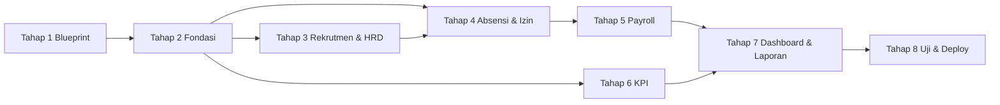

# DEVELOPMENT ROADMAP — Aplikasi Kepegawaian PIS

| Atribut | Nilai |
|---|---|
| Versi | 1.0 |
| Tanggal | 18-11-2026 |
| Prinsip | Satu proyek, satu database, satu tahap pada satu waktu |
| Acuan | `MASTER_SPECIFICATION.md`, `SRS.md` |

> Ukuran usaha memakai skala relatif (S/M/L/XL) untuk perencanaan, **bukan** janji tanggal. Setiap tahap hanya boleh dimulai setelah tahap sebelumnya memenuhi kriteria keluar.

---

## Ringkasan tahap

| Tahap | Fokus | Status |
|---|---|---|
| 1 | Analisis & desain (blueprint) | **Selesai — dokumen tersedia** |
| 2 | Fondasi: login, RBAC, master pegawai, organisasi, audit | Belum dimulai |
| 3 | Rekrutmen & administrasi HRD | Belum dimulai |
| 4 | Absensi GPS + selfie, izin & cuti | Belum dimulai |
| 5 | Penggajian & slip gaji | Belum dimulai |
| 6 | KPI & pembinaan | Belum dimulai |
| 7 | Dashboard, laporan, notifikasi | Belum dimulai |
| 8 | Pengujian menyeluruh, keamanan, deployment, UAT | Belum dimulai |

---

## Tahap 1 — Analisis dan desain

**Status: selesai (18-11-2026).**

| Deliverable | Berkas | Status |
|---|---|---|
| SRS | `docs/SRS.md` | ✅ |
| Desain database + ERD | `docs/DATABASE_DESIGN.md` | ✅ |
| Proses bisnis | `docs/BUSINESS_PROCESS.md` | ✅ |
| UI/UX | `docs/UI_UX_SPECIFICATION.md` | ✅ |
| Matriks hak akses | `docs/ACCESS_CONTROL.md` | ✅ |
| Arsitektur teknis | `docs/TECHNICAL_ARCHITECTURE.md` | ✅ |
| Roadmap | `docs/DEVELOPMENT_ROADMAP.md` | ✅ |
| Spesifikasi induk | `docs/MASTER_SPECIFICATION.md` | ✅ |
| Daftar klarifikasi | `docs/CLARIFICATIONS.md` | ✅ |

**Kriteria keluar:** dokumen konsisten, setiap kebutuhan memiliki ID, ERD mendukung Tahap 2–8, tidak ada kebijakan yang dikarang.

---

## Tahap 2 — Fondasi sistem dan master data

**Tujuan:** aplikasi berjalan dengan login, RBAC, organisasi, master pegawai, riwayat, impor Excel, dan audit trail.

### Pekerjaan

| # | Pekerjaan | Ukuran | Ketergantungan |
|---|---|---|---|
| 2.1 | Instal PHP 8.4, Composer, MySQL 8.4, Git; verifikasi | M | — |
| 2.2 | Buat proyek Laravel 13 + Livewire + Tailwind; struktur folder | M | 2.1 |
| 2.3 | Konfigurasi `.env`, timezone, storage privat, queue/cache/session database | S | 2.2 |
| 2.4 | Migration seluruh tabel Tahap 2 (akses, organisasi, pegawai, sistem dasar) | L | 2.2 |
| 2.5 | Seeder role, permission, admin awal, pendidikan, pengaturan dasar | M | 2.4 |
| 2.6 | Autentikasi (login, logout, ganti/reset password, akun aktif, rate limit, audit login) | M | 2.5 |
| 2.7 | Manajemen pengguna + penetapan peran & cakupan unit | M | 2.6 |
| 2.8 | Layout aplikasi: sidebar per peran, topbar, notifikasi placeholder, responsif | M | 2.6 |
| 2.9 | Struktur organisasi, jabatan, lokasi kerja, shift, jadwal, hari libur | L | 2.8 |
| 2.10 | Master pegawai (CRUD, profil bertab, keluarga, pendidikan, rekening, dokumen) | XL | 2.9 |
| 2.11 | Riwayat status, jabatan, unit, atasan (append-only) | M | 2.10 |
| 2.12 | Penomoran otomatis NIP + validasi keunikan | S | 2.10 |
| 2.13 | Impor/ekspor Excel pegawai + laporan kesalahan per baris | L | 2.10 |
| 2.14 | Profil penggajian pegawai (pendidikan, jarak, BPJS, pajak) | M | 2.10 |
| 2.15 | Audit trail + halaman audit | M | 2.6 |
| 2.16 | Pengujian (unit + feature + otorisasi negatif) | L | 2.1–2.15 |
| 2.17 | Dokumentasi instalasi + progres + changelog | S | semua di atas |

### Kriteria keluar
1. Administrator dapat membuat pengguna dan menghubungkannya ke pegawai.
2. Setiap peran hanya melihat menu/data sesuai `ACCESS_CONTROL.md`.
3. CRUD pegawai, organisasi, dan riwayat berjalan; NIP unik.
4. Impor Excel menghasilkan laporan sukses/gagal per baris; tidak ada data setengah jadi.
5. Audit trail mencatat perubahan penting (before/after).
6. Semua pengujian Tahap 2 dijalankan dan dicatat di `TEST_REPORT.md`.
7. Aplikasi dapat dijalankan ulang dari dokumentasi instalasi.

### Risiko
- Instalasi PHP/MySQL memerlukan hak administrator.
- Data Excel awal tidak konsisten → butuh templat dan validasi ketat.
- Perubahan struktur organisasi dapat memengaruhi scope akses → uji ulang otorisasi.

---

## Tahap 3 — Rekrutmen dan administrasi HRD

**Tujuan:** proses pelamar → pegawai, kontrak, SK, mutasi, surat, arsip.

| # | Pekerjaan | Ukuran |
|---|---|---|
| 3.1 | Migration rekrutmen, kontrak, SK, mutasi, surat | M |
| 3.2 | Lowongan & pelamar (data, dokumen, status) | L |
| 3.3 | Seleksi administrasi, wawancara, penilaian berbobot | M |
| 3.4 | Keputusan penerimaan + konversi pelamar → pegawai | M |
| 3.5 | Kontrak kerja + perpanjangan + pengingat H-30/H-14/H-7 | L |
| 3.6 | SK (pengangkatan/penempatan/perubahan jabatan/mutasi/pemberhentian) | L |
| 3.7 | Mutasi & perubahan jabatan + riwayat | M |
| 3.8 | Template dokumen, penomoran, cetak PDF | M |
| 3.9 | Surat teguran/pembinaan/pemberhentian | M |
| 3.10 | Alur persetujuan per jenis dokumen | M |
| 3.11 | Pengujian alur end-to-end + otorisasi | L |
| 3.12 | Dokumentasi modul | S |

**Kriteria keluar:** satu pelamar dapat diproses hingga menjadi pegawai aktif tanpa input ulang; kontrak & SK tersimpan dengan PDF; mutasi memperbarui penempatan aktif dan riwayat; alur persetujuan berjalan dan tercatat.

**Ketergantungan:** master pegawai, penomoran, RBAC, audit (Tahap 2).

---

## Tahap 4 — Absensi, kedisiplinan, dan perizinan

**Tujuan:** presensi mandiri GPS + selfie yang dapat diuji dan dipertanggungjawabkan.

| # | Pekerjaan | Ukuran |
|---|---|---|
| 4.1 | Migration absensi, koreksi, dispensasi, izin, saldo | M |
| 4.2 | Halaman presensi mobile: GPS, radius, kamera, kompresi, idempotency | XL |
| 4.3 | Perhitungan keterlambatan/pulang awal/menit kerja | M |
| 4.4 | Pencegahan presensi ganda (DB + aplikasi) | M |
| 4.5 | Riwayat absensi pegawai + bukti foto | M |
| 4.6 | Koreksi absensi 2 tingkat (atasan → HRD) | L |
| 4.7 | Dispensasi GPS/kamera dengan bukti | M |
| 4.8 | Jadwal, shift, libur, pengecualian | M |
| 4.9 | Rekap kehadiran + laporan | L |
| 4.10 | Izin/cuti: pengajuan, dokumen, saldo, persetujuan | L |
| 4.11 | Integrasi rekap ke payroll (snapshot) | M |
| 4.12 | Pengujian GPS (dalam/luar/akurasi rendah), kamera, ganda, lintas hari, jaringan buruk | L |
| 4.13 | Dokumentasi + panduan pegawai | S |

**Kriteria keluar:** presensi berhasil di HP dengan foto & GPS; di luar radius ditolak dan dapat didispensasi; presensi ganda dicegah; rekap dapat ditelusuri; koreksi dua tingkat berjalan; data siap dipakai payroll.

**Catatan:** uji lapangan wajib di lokasi nyata; tanpa koordinat/radius final (K-13/K-14), gunakan lokasi DEMO.

---

## Tahap 5 — Penggajian dan slip gaji

**Tujuan:** payroll akurat, dapat diverifikasi, terkunci, dan menghasilkan slip PDF.

| # | Pekerjaan | Ukuran |
|---|---|---|
| 5.1 | Migration komponen, tarif, basis, transport, BPJS, pajak, periode, run, detail | L |
| 5.2 | Seeder konfigurasi awal PIS (ditandai versi) | M |
| 5.3 | UI master komponen & tarif bertanggal | L |
| 5.4 | Periode payroll + alur status + kontrol akses | M |
| 5.5 | Generator snapshot absensi & izin | M |
| 5.6 | Kalkulator: gaji harian, basis pendidikan, tunjangan, transport, kehadiran, snack, THR, bonus | XL |
| 5.7 | Potongan: alpa, terlambat, BPJS pegawai, PPh 21 | L |
| 5.8 | Prorata masuk/keluar + masa percobaan | M |
| 5.9 | Pemeriksaan anomali + koreksi/penyesuaian | M |
| 5.10 | Verifikasi HRD → Keuangan → Pimpinan → kunci | M |
| 5.11 | Slip gaji PDF individual & batch | M |
| 5.12 | Laporan gaji/tunjangan/potongan/BPJS/pajak/transfer | L |
| 5.13 | Pengujian perbandingan manual untuk semua kategori & kasus | XL |
| 5.14 | Dokumentasi rumus & konfigurasi | M |

**Kriteria keluar:** hasil aplikasi sama dengan perhitungan manual pada kasus uji yang disepakati; setiap angka dapat ditelusuri; periode terkunci tidak berubah tanpa prosedur; slip PDF benar; tidak ada perhitungan ganda.

**Blocker:** K-01 s.d. K-12 (kebijakan payroll) harus dikonfirmasi sebelum payroll produksi.

---

## Tahap 6 — KPI dan pembinaan

| # | Pekerjaan | Ukuran |
|---|---|---|
| 6.1 | Migration periode, template, indikator, penilaian, pembinaan | M |
| 6.2 | UI template indikator + validasi bobot 100% | M |
| 6.3 | Form penilaian kepala bagian + hitung nilai/predikat | L |
| 6.4 | Verifikasi HRD + persetujuan pimpinan + kunci | M |
| 6.5 | Riwayat, grafik tren, perbandingan periode | M |
| 6.6 | Evaluasi triwulanan (agregasi) | M |
| 6.7 | Catatan pembinaan + tindak lanjut + surat | M |
| 6.8 | Integrasi profil/laporan (tanpa efek payroll) | S |
| 6.9 | Pengujian alur & otorisasi | L |

**Kriteria keluar:** kepala bagian menilai bawahannya, HRD memverifikasi, pimpinan menyetujui, hasil terlihat sesuai kewenangan, KPI tidak mengubah gaji/status.

---

## Tahap 7 — Dashboard, laporan, notifikasi

| # | Pekerjaan | Ukuran |
|---|---|---|
| 7.1 | Dashboard 5 peran dengan scope data | L |
| 7.2 | 14 laporan + filter + ekspor Excel/PDF | XL |
| 7.3 | Notifikasi (kontrak, izin, koreksi, persetujuan, KPI, dokumen, payroll) | M |
| 7.4 | Pekerjaan terjadwal (pengingat, rekap) | M |
| 7.5 | Uji konsistensi angka dashboard vs laporan vs database | L |
| 7.6 | Optimasi query & cache | M |

**Kriteria keluar:** setiap peran memperoleh dashboard sesuai kewenangan; laporan memakai database yang sama; ekspor konsisten dengan filter; notifikasi tidak membocorkan data.

---

## Tahap 8 — Pengujian, keamanan, deployment

| # | Pekerjaan | Ukuran |
|---|---|---|
| 8.1 | Pengujian fungsional seluruh modul | XL |
| 8.2 | Pengujian integrasi antar modul | L |
| 8.3 | Pengujian keamanan (OWASP, IDOR, upload, session, akses langsung) | L |
| 8.4 | Pengujian absensi lapangan (GPS, kamera, perangkat berbeda, jaringan) | L |
| 8.5 | Pengujian payroll vs manual (semua kategori) | L |
| 8.6 | Pengujian performa (1.000 pegawai, 50 pengguna) | M |
| 8.7 | Backup & uji restore | M |
| 8.8 | Deployment produksi (domain, HTTPS, cron, queue, monitoring) | L |
| 8.9 | Dokumentasi operasional 10 dokumen + panduan per peran | L |
| 8.10 | UAT dengan pimpinan & pengelola | L |
| 8.11 | Perbaikan temuan kritis + verifikasi ulang | L |

**Kriteria penerimaan:** semua modul berfungsi, integrasi lulus, tidak ada celah kritis, backup/restore teruji, UAT ditandatangani, dokumentasi tersedia.

---

## Ketergantungan antar tahap

Catatan: Tahap 3 dan 4 sama-sama bergantung pada Tahap 2; Tahap 5 bergantung pada Tahap 4 (data absensi) dan Tahap 2 (profil gaji). Urutan 3 → 4 → 5 dipertahankan agar integrasi tidak melompat.

---

## Definisi "selesai" (berlaku semua tahap)

1. Fitur sesuai ruang lingkup dibuat.
2. Fitur dapat dijalankan pada lingkungan nyata.
3. Pengujian relevan dijalankan dan hasilnya dicatat.
4. Tidak ada masalah kritis terbuka.
5. Dokumentasi (`DEVELOPMENT_PROGRESS.md`, `CHANGELOG.md`, `TEST_REPORT.md`) diperbarui.
6. Tahap berikutnya dapat dilanjutkan tanpa merusak hasil sebelumnya.
